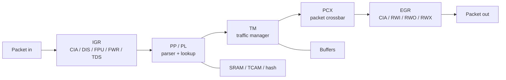

# CMODEL

## 定义

CMODEL（C/C++ 功能模型，用软件模拟芯片行为；用于早期软件开发和回归）是交换 ASIC（专用集成电路，为特定任务定制的芯片；用于交换、网络等大批量场景）的预编译功能模型：`libcx_model.so` + `libutils.so`，由 asic-cosim 的 `clxsim_cmodel_t` 驱动。

## 如何工作

- CMake 链接预编译库：
  - `${PREBUILT_PATH}/lib/libcx_model.so`
  - `${PREBUILT_PATH}/lib/libutils.so`
- 模型覆盖交换流水线：PP/PL/TM（Traffic Manager，流量管理器；负责队列、调度与缓存）/PCX（Packet Crossbar，报文交叉开关；负责切片间报文转发）/CSS/IGR（Ingress，入方向处理流水线；用于解析、查表和准入）/EGR（Egress，出方向处理流水线；用于报文修改与转发）/FPU、bloomfilter（布隆过滤器，概率型集合查询结构；用于快速判断表项是否存在）、hash（哈希表，按关键字映射的查找结构；用于精确匹配与负载均衡）、PacketGen（报文生成器，按模板构造测试流量；用于灌包测试）、parser、sampler。
- `clxsim_cmodel_t` 实现 `clxsim_chip_i`，提供 startup/shutdown/ticking/recirc 等接口。
- 支持 packet send/recv、寄存器访问、backdoor load（backdoor，后门访问，绕过正常总线直接读写内部存储；用于快速预置模型状态）。

## 架构图

## 关键细节

- NB：1 pie（芯片内部的转发分区单位；用于按容量扩展交换能力）× 25.6T；KG：2 pie × 51.2T。
- 8 slices（芯片内可复用的端口/流水线切片；用于横向扩展端口数）/pie、4 front-panel MAC/slice、8 PAM4（4-level Pulse Amplitude Modulation，四电平脉冲幅度调制；用于高速 SerDes 传输）112Gbps SerDes（Serializer/Deserializer，串并转换器；用于芯片间高速串行链路）/MAC（NB），KG 为 16 SerDes/MAC。
- 端口/切片常量：`PIE_PER_CHIP`、`SLICE_PER_PIE`、`PORT_PER_SLICE`、`FP_PORT_PER_SLICE`。
- chassis 索引偏移：source/tunnel/LAG/L2MC/L3MC 各有 per-slot offset。

## 在项目中的位置

- 所属项目：[[ASIC-Cosim]]
- 相关子系统：[[ASIC-Cosim-Five-Backends]]、[[ASIC-Cosim-SAI-PTF]]

## 相关概念

- [[Verification-Fidelity]]
- [[Performance-Modeling]]

## 自检问题

- C-model 的“功能级”具体省略了哪些时序细节？
- 25.6T/51.2T 与 slice/MAC/SerDes 的关系？
- backdoor load 与 frontdoor AXI load 的差异？
- chassis 索引偏移为什么按 slot 计算？

## 概念速览

| 概念 | 是什么 | 使用场景 | 延伸 |
|---|---|---|---|
| CMODEL | C/C++ 功能模型 | 早期软件开发、日常回归 | 与 RTL 相比快但时序不精确，适合功能验证 |
| ASIC | 专用集成电路 | 交换、网络等大批量场景 | 模型验证的目标是流片前发现功能缺陷 |
| TM | 流量管理器 | 队列、调度、缓存管理 | 缓存溢出与调度公平性问题常在此暴露 |
| PCX | 报文交叉开关 | 切片间报文转发 | 关注带宽与无阻塞交换能力 |
| IGR | 入方向流水线 | 解析、查表、准入 | 与 EGR 对称，通常先于 EGR 处理报文 |
| EGR | 出方向流水线 | 报文修改与转发 | 与 IGR 共享表项但处理方向相反 |
| bloomfilter | 概率型集合查询结构 | 快速判断表项是否存在 | 有假阳性无假阴性，命中后仍需精确查表 |
| hash | 哈希表 | 精确匹配、负载均衡 | 冲突处理策略会影响查表时延与容量 |
| PacketGen | 报文生成器 | 灌包测试 | 可按模板构造流量，常与 pcap 回放配合 |
| backdoor | 后门访问 | 快速预置模型状态 | 绕过正常总线，适合调试但不代表真实路径 |
| pie | 芯片内部转发分区单位 | 按容量扩展交换能力 | NB 为 1 pie、KG 为 2 pie，容量翻倍 |
| slice | 芯片内端口/流水线切片 | 横向扩展端口数 | 端口常量常按 slice 组织，便于配置复用 |
| PAM4 | 四电平脉冲幅度调制 | 高速 SerDes 传输 | 每符号传 2 bit，是 112G 链路的基础 |
| SerDes | 串并转换器 | 芯片间高速串行链路 | 速率提升依赖 PAM4 与均衡技术 |

## 来源

- `src/cosim/cmodel/cmodel.h`
- `CMakeLists.txt`
- `config/skucfg/`
