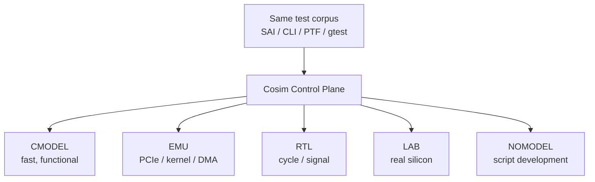

# 五种执行后端

## 定义

asic-cosim 用统一的控制面——SAI（Switch Abstraction Interface，交换机抽象接口标准；用于统一不同交换芯片的配置 API）、CLI（Command Line Interface，命令行接口；用于人工调试和脚本化命令）、PTF（Packet Test Framework，报文测试框架；用于交换芯片数据面测试）——驱动五种执行环境，用保真度（fidelity，模型与真实硬件行为的一致程度；用于权衡仿真速度与可信度）换速度。

| 后端 | 模型 | 速度 | 保真度 | 典型用途 |
|---|---|---|---|---|
| CMODEL（C/C++ 功能模型，用软件模拟芯片行为；用于早期软件开发与日常回归） | 预编译 `libcx_model.so` | 快 | 功能级 | 日常回归、表项/包转发 |
| EMU（Emulation，硬件仿真平台；用于流片前跑驱动与系统级软件） | PCIe（Peripheral Component Interconnect Express，高速串行外设总线；用于主机与设备互联）/knet + DMA ring | 中 | 内核/PCIe 路径 | 驱动、中断、DMA |
| RTL（Register Transfer Level，寄存器传输级硬件描述；用于周期精确仿真） | DPI（Direct Programming Interface，SystemVerilog 与 C 的互调接口；用于 RTL 与控制面联仿）连接 RTL DUT | 慢 | 周期/信号级 | 微架构、时序、联调 |
| LAB（真实硬件实验室后端，连接板卡；用于硅后验证） | i2c/PCIe 真实硬件 | 真实 | 硅后 | 实验室验证、模拟前端 |
| NOMODEL（无模型模式，仅运行控制面；用于脚本和测试框架开发） | 无模型 | 最快 | 无 | Python 脚本/测试框架开发 |

## 架构图

## 如何工作

- `cmodel`：`clxsim_cmodel_t` 实现 `clxsim_chip_i`，链接 `libcx_model.so`/`libutils.so`。
- `emu`：`clxsim_emu_t` 继承 `clxsim_rtl_t`，通过 PCIe/knet 访问设备，维护 DMA ring（DMA，Direct Memory Access，直接内存访问；ring 为描述符环形队列，用于设备与内存间无 CPU 搬运数据）与 FIFO。
- `rtl`：`nbrtl_*` DPI API，支持寄存器读写、收发包、复位、命令。
- `lab`：`lab_access`/`lab_i2c`/`lab_cli`，访问真实硬件。
- `nomodel`：只跑控制面/脚本。

## 关键细节

- `sim_level`：0-API、1-Register。
- `--backdoor_load`（backdoor，后门访问，绕过正常总线直接读写内部存储；用于快速预置模型状态）可直接把 ELF 写入仿真 SRAM。
- CMODEL/EMU/RTL 都能接 SAI-Thrift（Thrift，跨语言 RPC 框架；用于 SAI 客户端与芯片服务通信，默认 6800）与 CLI（默认 6500）。
- 同一测试脚本可切换后端，但不同后端的可见问题不同。

## 在项目中的位置

- 所属项目：[[ASIC-Cosim]]
- 相关子系统：[[ASIC-Cosim-CMODEL]]、[[ASIC-Cosim-EMU]]、[[ASIC-Cosim-RTL-DPI]]、[[ASIC-Cosim-SAI-PTF]]

## 相关概念

- [[Verification-Fidelity]]
- [[Performance-Modeling]]

## 自检问题

- 哪些 bug 只能在 RTL 暴露，哪些在 CMODEL 就能发现？
- EMU 与 RTL 的边界在哪里？
- LAB 后端为什么不可替代？
- 如何保证同一用例在不同后端上可比？

## 概念速览

| 概念 | 是什么 | 使用场景 | 延伸 |
|---|---|---|---|
| SAI | 交换机抽象接口标准 | 统一不同交换芯片的配置 API | 同一用例跨后端复用的关键前提 |
| CLI | 命令行接口 | 人工调试、脚本化命令 | 后端切换时命令入口保持不变 |
| PTF | 报文测试框架 | 交换芯片数据面测试 | 数据面用例通常不感知具体后端 |
| 保真度 | 模型与真实硬件行为的一致程度 | 权衡仿真速度与可信度 | 速度与保真度通常成反比，需按问题选层 |
| CMODEL | C/C++ 功能模型 | 日常回归、表项/包转发 | 最快，适合大规模功能回归 |
| EMU | 硬件仿真平台 | 驱动、中断、DMA 验证 | 多出内核/PCIe 路径，能暴露驱动问题 |
| PCIe | 高速串行外设总线 | 主机与设备互联 | EMU 模拟设备枚举与 BAR 映射 |
| RTL | 寄存器传输级硬件描述 | 周期/信号级仿真 | 最慢但能看微架构与时序 |
| DPI | SystemVerilog 与 C 的互调接口 | RTL 与控制面联仿 | RTL 后端的核心连接机制 |
| LAB | 真实硬件实验室后端 | 硅后验证 | 不可替代，因为只有它能跑真实模拟前端 |
| NOMODEL | 无模型模式 | 脚本/测试框架开发 | 不执行芯片行为，适合先验证测试流程 |
| DMA | 直接内存访问 | 设备与内存间无 CPU 搬运数据 | EMU 用描述符环管理收发 |
| backdoor | 后门访问 | 快速预置模型状态 | 绕过正常总线，不能替代 frontdoor 验证 |
| Thrift | 跨语言 RPC 框架 | SAI 客户端与芯片服务通信 | 默认 6800 端口，后端需实现同一 RPC 接口 |

## 来源

- `README.md`
- `src/cosim/cmodel/cmodel.h`
- `src/cosim/emu/emu.h`
- `src/cosim/rtl/rtl_dpi.h`
