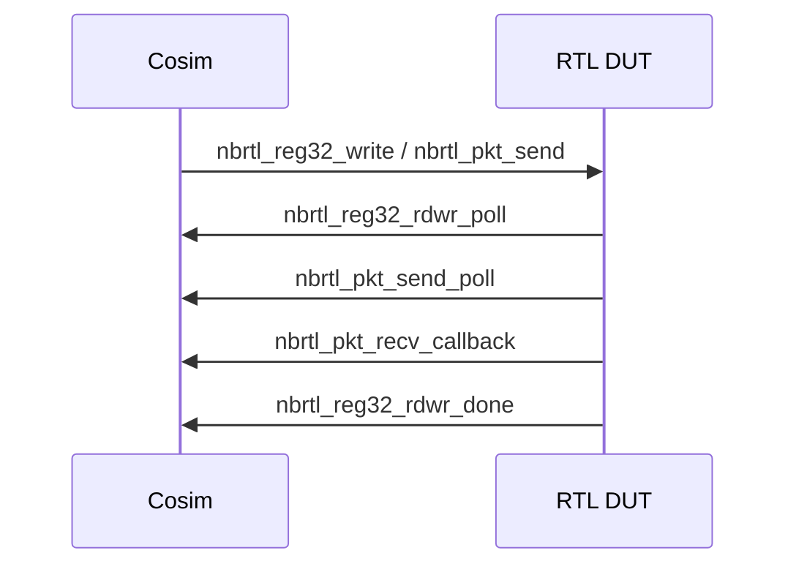

# RTL DPI 后端

## 定义

RTL 后端通过 DPI 把仿真器里的 RTL DUT 接到 cosim 控制面：cosim 侧发起寄存器/包/复位/命令，RTL 侧轮询并回调完成。

## 如何工作

DPI API（`rtl_dpi.h`）：

- `nbrtl_start_cosim(bg, ipython, icling, cli, cliport, rpcport)`
- `nbrtl_reg32_read/write(inst, offset, num, values)`
- `nbrtl_reg32_rdwr_poll/done`
- `nbrtl_pkt_send` / `nbrtl_pkt_send_poll/done`
- `nbrtl_pkt_recv_callback`
- `nbrtl_hard_reset/unreset`
- `nbrtl_cmd` / `nbrtl_cmd_poll`

方向约定：

- cosim → RTL：read/write/send/reset/cmd 的发起。
- RTL → cosim：poll 取请求、done 回调、recv 回调。

## 架构图

## 关键细节

- 支持多实例（`inst` 参数），可做 multi-DUT。
- `nbrtl_cmd` 可把命令字符串/参数/数据传入 RTL。
- RTL 后端最慢，但能看周期/信号/时序问题。
- 与 EMU 共享 `clxsim_rtl_t` 基类。

## 在项目中的位置

- 所属项目：[[ASIC-Cosim]]
- 相关子系统：[[ASIC-Cosim-Five-Backends]]、[[ASIC-Cosim-EMU]]

## 相关概念

- [[Verification-Fidelity]]
- [[Performance-Modeling]]

## 自检问题

- DPI 的 poll/done 机制如何避免阻塞仿真？
- 多实例 DUT 如何隔离寄存器/包空间？
- 哪些 bug 只能在 RTL 后端发现？
- RTL 后端如何与 SAI/PTF 对接？

## 来源

- `src/cosim/rtl/rtl_dpi.h`
- `src/cosim/rtl/`
