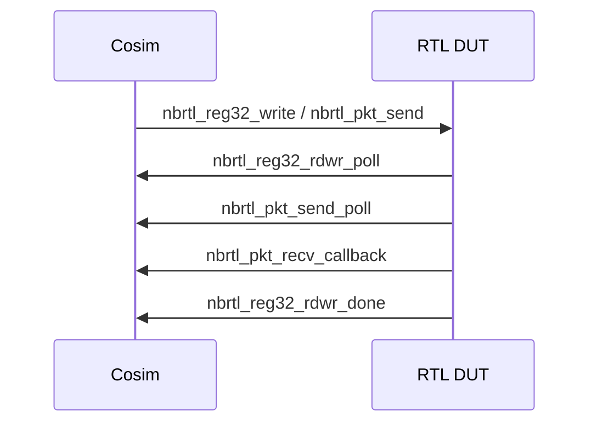

# RTL DPI 后端

## 定义

RTL（Register Transfer Level，寄存器传输级硬件描述；用于周期精确仿真）后端通过 DPI（Direct Programming Interface，SystemVerilog 与 C 的互调接口；用于 RTL 与 C 控制面联仿）把仿真器（simulator，执行 RTL 仿真的软件；用于运行 DUT 与测试平台）里的 RTL DUT（Device Under Test，被测设备/设计；用于区分被测 RTL 与测试平台）接到 cosim（co-simulation，协同仿真；用于软件控制面与硬件模型联合运行）控制面：cosim 侧发起寄存器（register，芯片内可读写的配置/状态单元；用于配置与查询）/包/复位（reset，把电路恢复到确定初始状态；用于测试前初始化）/命令，RTL 侧轮询（polling，主动反复查询状态；用于避免阻塞仿真）并回调完成。

## 如何工作

DPI API（Application Programming Interface，应用程序接口；用于封装寄存器/包操作）（`rtl_dpi.h`）：

- `nbrtl_start_cosim(bg, ipython, icling, cli, cliport, rpcport)`
- `nbrtl_reg32_read/write(inst, offset, num, values)`
- `nbrtl_reg32_rdwr_poll/done`
- `nbrtl_pkt_send` / `nbrtl_pkt_send_poll/done`
- `nbrtl_pkt_recv_callback`
- `nbrtl_hard_reset/unreset`
- `nbrtl_cmd` / `nbrtl_cmd_poll`

方向约定：

- cosim → RTL：read/write/send/reset/cmd 的发起。
- RTL → cosim：poll 取请求、done 回调、recv 回调。

## 架构图

## 关键细节

- 支持多实例（`inst` 参数），可做 multi-DUT。
- `nbrtl_cmd` 可把命令字符串/参数/数据传入 RTL。
- RTL 后端最慢，但能看周期（cycle，时钟节拍；用于周期级仿真与性能评估）/信号/时序（timing，信号相对时钟的先后关系；用于检查建立/保持与协议时序）问题。
- 与 EMU（Emulation，硬件仿真平台；用于流片前跑驱动与系统级软件）共享 `clxsim_rtl_t` 基类。

## 在项目中的位置

- 所属项目：[[ASIC-Cosim]]
- 相关子系统：[[ASIC-Cosim-Five-Backends]]、[[ASIC-Cosim-EMU]]

## 相关概念

- [[Verification-Fidelity]]
- [[Performance-Modeling]]

## 自检问题

- DPI 的 poll/done 机制如何避免阻塞仿真？
- 多实例 DUT 如何隔离寄存器/包空间？
- 哪些 bug 只能在 RTL 后端发现？
- RTL 后端如何与 SAI/PTF 对接？

## 概念速览

| 概念 | 是什么 | 使用场景 | 延伸 |
|---|---|---|---|
| RTL | 寄存器传输级硬件描述 | 周期/信号级仿真 | 最慢但最接近真实硬件时序 |
| DPI | SystemVerilog 与 C 的互调接口 | RTL 与 C 控制面联仿 | 需注意跨语言数据类型的宽度与符号 |
| 仿真器 | 执行 RTL 仿真的软件 | 运行 DUT 与测试平台 | 不同仿真器对 DPI 的支持细节可能不同 |
| DUT | 被测设备/设计 | 区分被测 RTL 与测试平台 | multi-DUT 时需按实例隔离寄存器/包空间 |
| cosim | 协同仿真 | 软件控制面与硬件模型联合运行 | 控制面与 RTL 时钟域不同，需异步交互 |
| 寄存器 | 芯片内可读写配置/状态单元 | 配置与查询 | 读写需成对使用 poll/done 避免阻塞 |
| 复位 | 把电路恢复到确定初始状态 | 测试前初始化 | 硬复位与解复位需成对调用 |
| 轮询 | 主动反复查询状态 | 避免阻塞仿真 | 与 done 回调配合构成非阻塞完成机制 |
| API | 应用程序接口 | 封装寄存器/包操作 | 接口稳定后控制面可复用于多种后端 |
| 周期 | 时钟节拍 | 周期级仿真与性能评估 | 周期精确是 RTL 相对 CMODEL 的核心价值 |
| 时序 | 信号相对时钟的先后关系 | 检查建立/保持与协议时序 | 时序问题通常只能在 RTL 或 LAB 暴露 |
| EMU | 硬件仿真平台 | 驱动、PCIe、中断验证 | 与 RTL 共享基类，但多出内核路径 |

## 来源

- `src/cosim/rtl/rtl_dpi.h`
- `src/cosim/rtl/`
