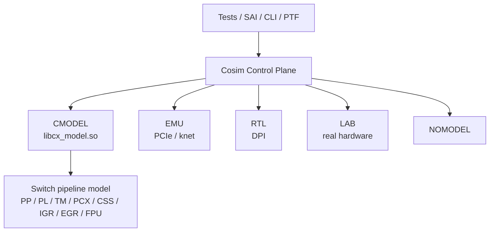

# ASIC-Cosim

## 一句话定位

Clounix 内部 ASIC（专用集成电路，为特定任务定制的芯片；用于交换、AI、网络等大批量场景）验证协同仿真（co-simulation，软件控制面与芯片模型联合运行；用于流片前验证功能）环境：同一套 SAI（Switch Abstraction Interface，交换机抽象接口标准；用于统一不同交换芯片的配置 API）/CLI（Command Line Interface，命令行接口；用于人工调试和脚本化下发命令）/PTF（Packet Test Framework，报文测试框架；用于交换芯片数据面测试）控制面，接 CMODEL（C/C++ 功能模型，用软件模拟芯片行为；用于早期软件开发和回归）/EMU（Emulation，硬件仿真平台；用于流片前跑驱动与系统级软件）/RTL（Register Transfer Level，寄存器传输级硬件描述；用于周期精确仿真）/LAB/NOMODEL（无模型模式，仅运行控制面；用于脚本和测试框架开发）五种执行后端。

## 架构骨架

- 后端：CMODEL（预编译 `libcx_model.so`）、EMU（PCIe/knet）、RTL（DPI）、LAB（真实硬件）、NOMODEL
- C-model：交换流水线 PP/PL/TM（Traffic Manager，流量管理器；负责队列、调度与缓存）/PCX（Packet Crossbar，报文交叉开关；负责切片间报文转发）/CSS/IGR（Ingress，入方向处理流水线；用于解析、查表和准入）/EGR（Egress，出方向处理流水线；用于报文修改与转发）/FPU、bloomfilter（布隆过滤器，概率型集合查询结构；用于快速判断表项是否存在）、hash、PacketGen
- 规模：NB 1 pie × 25.6T；KG 2 pie × 51.2T；112G PAM4 SerDes
- 控制面：SAI-Thrift、CLI telnet、PTF、pytest、gtest、pcap、traffic、chassis、netlink/FRR
- 调试：iPython / iCling / Jupyter / gdb / valgrind

## 架构图

## 关键子系统

- [[ASIC-Cosim-Five-Backends]]
- [[ASIC-Cosim-CMODEL]]
- [[ASIC-Cosim-EMU]]
- [[ASIC-Cosim-RTL-DPI]]
- [[ASIC-Cosim-SAI-PTF]]

## 相关概念

- [[Verification-Fidelity]]
- [[Software-Interface]]
- [[Cache-and-Memory]]（对照模型内存/backdoor）

## 学习阶段

- [[Stage-4-Verification]]

## 代码阅读路线

按“总览 → 后端入口 → 统一访问口 → 单个后端 → 流水线模型 → 测试”的顺序读；路径相对 `source_repo`。五后端共享同一套入口，先横向对比，再纵向深入。

1. **先看清五后端的关系** — `README.md`、`src/cosim/cosim_app.hpp`、`src/cosim/cosim_app_c.cpp`
   - 看：同一套控制面如何选择后端，`cosim_app` 抽象了哪些动作（init/register access/packet）。
   - 读完能回答：CMODEL/EMU/RTL/LAB/NOMODEL 的共同接口是什么？
2. **横向对比五个入口** — `src/cosim/run_cosim_cmodel.cpp`、`run_cosim_rtl.cpp`、`run_cosim_emu.cpp`、`run_cosim_lab.cpp`、`run_cosim_nomodel.cpp`
   - 只读 `main` 与初始化顺序，不展开实现；比较谁注册了什么、谁打开了设备。
   - 读完能回答：换后端时控制面代码为什么不用改？
3. **看统一访问口** — `src/cosim/cmodel/cmodel_access.cpp`、`rtl/rtl_access.cpp`、`emu/emu_access.cpp`、`lab/lab_access.cpp`、`nomodel/nomodel.cpp`；C ABI 看 `cmodel/cmodel.h`
   - 读完能回答：寄存器读写、表项读写、backdoor 在五后端如何保持同一语义？
4. **深入 CMODEL** — `src/cosim/cmodel/cmodel.cpp` → `cmodel/nb/cmodel_nb.cpp` 或 `cmodel/kg/cmodel_kg.cpp`；backdoor 看 `cmodel/nb/cmodel_backdoor.cpp`
   - 读完能回答：C-model 的流水线模型如何组织？软件 backdoor 与正常寄存器路径差别在哪？
5. **深入 RTL/DPI** — `src/cosim/rtl/rtl.cpp` → `rtl/rtl_dpi.cpp` + `rtl/rtl_dpi.h`；前端口看 `rtl/rtl_frontport.cpp`
   - 读完能回答：DPI 调用在什么边界穿过 SV/C？周期推进由谁驱动？
6. **深入 EMU** — `src/cosim/emu/emu.cpp` → `emu/emu_pcie.cpp`、`emu/emu_dma.cpp`、`emu/emu_irq.cpp`、`emu/emu_cpuport.cpp`；内核侧看 `emu/nb-knet/`
   - 读完能回答：PCIe/knet 路径与 RTL 路径分别能暴露哪类问题？
7. **看交换流水线模型** — `src/cosim/mountains/README.md` → `mountains/nb/design.cpp` → `mountains/nb/pp/`（解析/入方向）→ `mountains/nb/pl/`（查表）→ `mountains/nb/tm/`（队列/调度）→ `mountains/nb/pcx/`（交叉开关）
   - 读完能回答：一个报文从入口到出口依次经过哪些模型？TM 的拥塞在哪里体现？
8. **用测试闭环** — `tests/features/README.md` → `tests/features/test_l2.cpp` → `run_feature_gtest.cpp`；数据面看 `saithriftv2/ptf/`
   - 读完能回答：同一个 feature test 在 CMODEL 与 RTL 上如何跑、结果如何比对？

## 实验记录

- [ ] 跑一个 feature gtest（cmodel）
- [ ] 对比 CMODEL 与 RTL 的同一用例
- [ ] 理解 EMU 的 PCIe/knet 路径
- [ ] 画五后端与 SAI/PTF 的关系图

## 开放问题

- 同一 SAI 用例在 CMODEL/RTL/LAB 上的差异如何自动比对？
- EMU 与 RTL 的边界：哪些问题只能在 EMU 暴露？
- 预编译 C-model 与 RTL 的版本如何保持同步？

## 概念速览

| 概念 | 是什么 | 使用场景 | 延伸 |
|---|---|---|---|
| ASIC | 专用集成电路 | 交换、AI、网络等大批量场景 | 与 FPGA 相比流片成本高，但量产功耗和单位成本更优 |
| 协同仿真 | co-simulation，控制面与芯片模型联合运行 | 流片前功能验证 | 保真度越高越慢，需按问题类型选择后端 |
| SAI | 交换机抽象接口标准 | 统一不同交换芯片的配置 API | 由 OCP 推动，SONiC 等网络操作系统依赖它 |
| CLI | 命令行接口 | 人工调试、脚本化命令 | 与 SAI 路径共享底层寄存器/表项访问 |
| PTF | 报文测试框架 | 交换芯片数据面测试 | 常与 pytest 组织用例、pcap 提供报文样例 |
| CMODEL | C/C++ 功能模型 | 早期软件开发、日常回归 | 快但时序不精确，适合功能级验证 |
| EMU | 硬件仿真平台 | 驱动、PCIe、中断、DMA 验证 | 比 RTL 快、比 CMODEL 慢，补齐内核路径 |
| RTL | 寄存器传输级硬件描述 | 周期/信号级仿真 | 最慢但能暴露微架构与时序问题 |
| NOMODEL | 无模型模式 | 脚本/测试框架开发 | 不执行芯片行为，只验证控制面流程 |
| TM | 流量管理器 | 队列、调度、缓存管理 | 拥塞与 QoS 问题通常先在此暴露 |
| PCX | 报文交叉开关 | 切片/端口间报文转发 | 与 TM、EGR 一起决定实际转发带宽 |
| IGR | 入方向流水线 | 解析、查表、准入 | 与 EGR 对称，常按 CIA/DIS/FPU 等子模块拆分 |
| EGR | 出方向流水线 | 报文修改与转发 | 与 IGR 共享表项但职责相反 |
| bloomfilter | 概率型集合查询结构 | 快速判断表项是否存在 | 有假阳性无假阴性，常配合 hash 表二次确认 |

## 来源

- `README.md`
- `src/cosim/CMakeLists.txt`
- `src/cosim/cmodel/cmodel.h`
