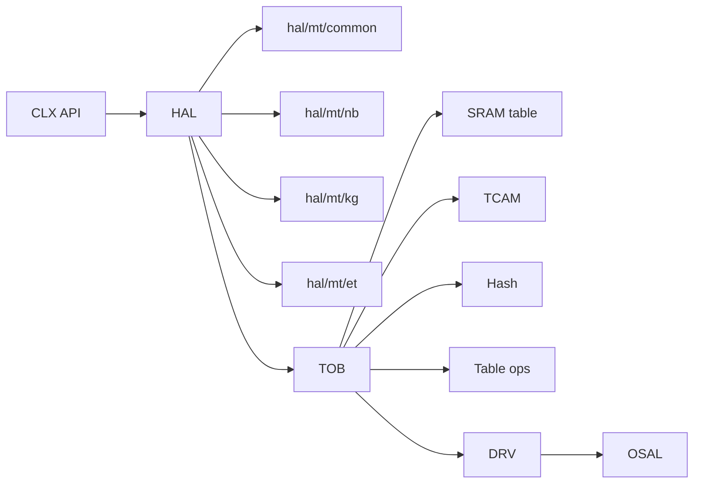

# HAL 与 TOB

## 定义

HAL（Hardware Abstraction Layer，硬件抽象层；承载芯片相关但 API 无关的逻辑）负责“芯片相关但 API 无关”的逻辑；TOB（Table Operation Bus）（表项操作抽象层，把 SRAM/TCAM/hash 差异藏在统一接口后；用于表项增删查改）负责“表项访问”的抽象，把 SRAM（Static RAM，静态随机存储器；存放 MAC/路由等高速表项）/TCAM（Ternary Content-Addressable Memory，三态内容寻址存储器，支持掩码匹配；用于 ACL、最长前缀匹配）/hash（哈希表，按键的哈希值定位表项；用于精确查找与 ECMP）的差异屏蔽在统一接口后面。

## 如何工作

### HAL

- `hal_*.c` 覆盖 L2/L3（Layer 2/Layer 3，二层交换与三层路由；转发核心功能）/TM/QoS（Quality of Service，服务质量，按优先级调度与限速；用于区分业务等级）/mirror/meter/LAG（Link Aggregation Group，链路聚合组，多链路捆绑；用于带宽叠加与冗余）/BFD（Bidirectional Forwarding Detection，双向转发检测；用于快速发现链路故障）/PTP（Precision Time Protocol，精确时间协议；用于纳秒级时钟同步）/telemetry（遥测，芯片主动上报计数与状态；用于监控与排障）/security/WLAN/VM/STP/SWC。
- `hal/mt/{nb,kg,et}` 放芯片特化实现；`hal/mt/common` 放公共逻辑；`hal/mock` 用于 mock（模拟实现，用软件替身替代真实硬件；用于无硬件单元测试）测试。
- HAL 向上提供与芯片无关的语义，向下调用 TOB/DRV。

### TOB

- `tob/mt/{sram,tcam,hash,tbl}`：不同表项类型的访问路径。
- `tob_tbl.c`：表项级操作（insert/delete/get/traverse）。
- `tob.h` 定义 `tob_entry_info_t`、`tob_fvp_t`、DMA（Direct Memory Access，直接内存访问；硬件直接搬移表项数据，减少 CPU 拷贝）内存对齐宏、instance 广播常量。
- 广播：`TOB_INST_IDX_BCAST`、`TOB_ODD/EVEN_INST_IDX_BCAST`、`TOB_MASTER/SLAVE_INST_IDX_BCAST`。

## 架构图

## 关键细节

- TOB 的 DMA 内存分配要求 16B 对齐（`TOB_DMA_MEM_ALLOC`）。
- `tob_entry_info_t` 携带 `table_id`、`flags`、`entry_idx`、`entry_num`、`bank_bmp`、`entry`。
- FVP（field-value pair）（字段-值对，按字段名读写表项；避免直接操作原始字节）用于按字段读写表项，避免直接操作原始字节。
- 表项引擎是交换 ASIC 的核心：查表/更新/老化/统计都走这条路径。

## 在项目中的位置

- 所属项目：[[Clounix-SDK]]
- 相关子系统：[[Clounix-SDK-Layering]]、[[Clounix-SDK-MultiChip]]

## 相关概念

- [[Software-Interface]]
- [[Cache-and-Memory]]（对照 cache/tag/表项抽象）

## 自检问题

- TOB 如何屏蔽 SRAM/TCAM/hash 的访问差异？
- FVP 与原始 buffer 两种接口各自的适用场景？
- instance 广播在什么场景使用？
- HAL 的 mock 层如何支持无硬件测试？

## 概念速览

| 概念 | 是什么 | 使用场景 | 延伸 |
|---|---|---|---|
| HAL | 硬件抽象层 | 芯片相关但 API 无关的逻辑 | 向上给语义、向下调 TOB/DRV，是移植的主要工作面 |
| TOB | 表项操作抽象 | 统一 SRAM/TCAM/hash 访问 | 没有 TOB 的话，HAL 需为每种表类型重复处理访问细节 |
| SRAM | 静态随机存储器 | 高速表项存储 | 容量大、成本低，但只支持精确匹配 |
| TCAM | 三态内容寻址存储器 | ACL、最长前缀匹配 | 支持掩码但功耗/成本高，容量通常很小 |
| hash | 哈希表 | 精确查找、ECMP | 冲突与老化策略影响容量和查找稳定性 |
| L2/L3 | 二层/三层转发 | 交换与路由 | 二者表项规模差异大，配置需按芯片规格设定 |
| QoS | 服务质量 | 优先级调度与限速 | 常与 TM 配合：QoS 定策略，TM 做队列调度 |
| LAG | 链路聚合组 | 带宽叠加与冗余 | 多芯片系统中需处理跨芯片 LAG 成员 |
| BFD | 双向转发检测 | 快速故障检测 | 与链路聚合/路由联动可缩短收敛时间 |
| PTP | 精确时间协议 | 纳秒级时钟同步 | 硬件时间戳精度依赖 PHY/SerDes 支持 |
| telemetry | 遥测 | 计数与状态上报 | 与轮询统计相比开销更低、实时性更好 |
| mock | 模拟实现 | 无硬件测试 | mock 层需与真实 HAL 语义保持一致，否则测试会失真 |
| DMA | 直接内存访问 | 搬移表项/报文数据 | 对齐与 cache 一致性是常见问题 |
| FVP | 字段-值对 | 按字段读写表项 | 比原始 buffer 更可读，但字段定义须与表结构严格对应 |

## 来源

- `clx_sdk/src/hal/`
- `clx_sdk/src/tob/`
- `clx_sdk/include/tob/tob.h`
