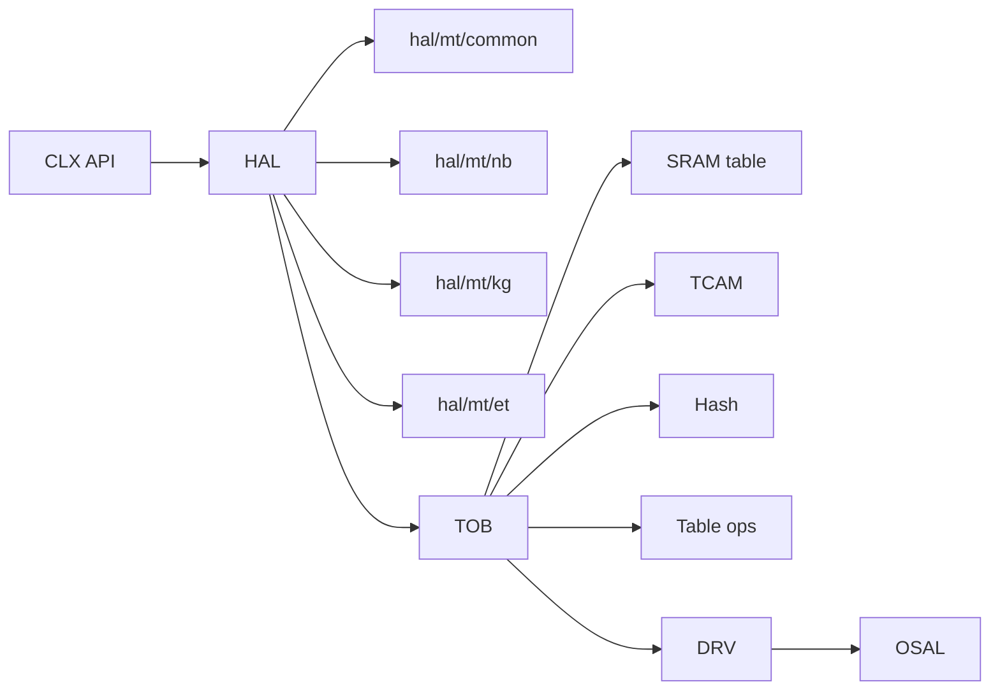

# HAL 与 TOB

## 定义

HAL 负责“芯片相关但 API 无关”的逻辑；TOB（Table Operation Bus）负责“表项访问”的抽象，把 SRAM/TCAM/hash 的差异屏蔽在统一接口后面。

## 如何工作

### HAL

- `hal_*.c` 覆盖 L2/L3/TM/QoS/mirror/meter/LAG/BFD/PTP/telemetry/security/WLAN/VM/STP/SWC。
- `hal/mt/{nb,kg,et}` 放芯片特化实现；`hal/mt/common` 放公共逻辑；`hal/mock` 用于 mock 测试。
- HAL 向上提供与芯片无关的语义，向下调用 TOB/DRV。

### TOB

- `tob/mt/{sram,tcam,hash,tbl}`：不同表项类型的访问路径。
- `tob_tbl.c`：表项级操作（insert/delete/get/traverse）。
- `tob.h` 定义 `tob_entry_info_t`、`tob_fvp_t`、DMA 内存对齐宏、instance 广播常量。
- 广播：`TOB_INST_IDX_BCAST`、`TOB_ODD/EVEN_INST_IDX_BCAST`、`TOB_MASTER/SLAVE_INST_IDX_BCAST`。

## 架构图

## 关键细节

- TOB 的 DMA 内存分配要求 16B 对齐（`TOB_DMA_MEM_ALLOC`）。
- `tob_entry_info_t` 携带 `table_id`、`flags`、`entry_idx`、`entry_num`、`bank_bmp`、`entry`。
- FVP（field-value pair）用于按字段读写表项，避免直接操作原始字节。
- 表项引擎是交换 ASIC 的核心：查表/更新/老化/统计都走这条路径。

## 在项目中的位置

- 所属项目：[[Clounix-SDK]]
- 相关子系统：[[Clounix-SDK-Layering]]、[[Clounix-SDK-MultiChip]]

## 相关概念

- [[Software-Interface]]
- [[Cache-and-Memory]]（对照 cache/tag/表项抽象）

## 自检问题

- TOB 如何屏蔽 SRAM/TCAM/hash 的访问差异？
- FVP 与原始 buffer 两种接口各自的适用场景？
- instance 广播在什么场景使用？
- HAL 的 mock 层如何支持无硬件测试？

## 来源

- `clx_sdk/src/hal/`
- `clx_sdk/src/tob/`
- `clx_sdk/include/tob/tob.h`
