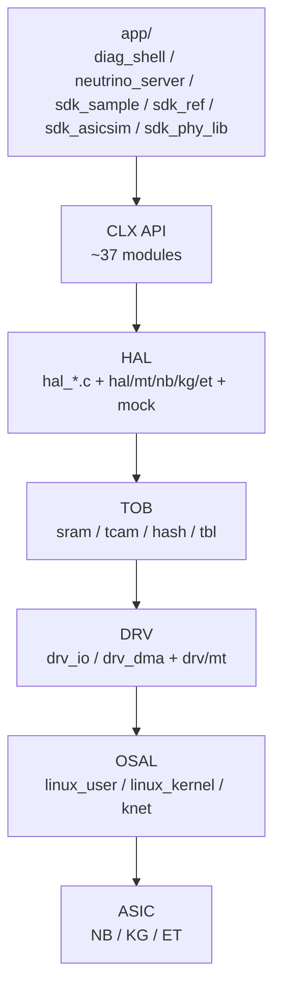

# Clounix SDK 分层

## 定义

SDK（Software Development Kit，软件开发工具包；把芯片能力封装成可调用接口）采用典型的交换芯片软件分层：CLX API（Clounix 芯片对外应用编程接口，约 37 个功能模块；应用通过它访问交换功能） → HAL（Hardware Abstraction Layer，硬件抽象层；屏蔽芯片代际差异） → TOB（Table Operation Bus，表项操作抽象；统一 SRAM/TCAM/hash 访问） → DRV（Driver，驱动层；负责寄存器 IO 与 DMA） → OSAL（Operating System Abstraction Layer，操作系统抽象层；屏蔽用户态/内核态差异），向上提供统一的 `clx_*` 接口，向下屏蔽芯片/总线/OS 差异。

## 如何工作

```text
app/        diag_shell · neutrino_server(RPC) · sdk_sample · sdk_ref · sdk_asicsim · sdk_phy_lib
   ↓
CLX API     ~37 个模块：L2/L3/VLAN/MPLS/SRv6/TM/QoS/mirror/meter/LAG/BFD/PTP/
            telemetry/security/WLAN/VM/STP/SWC/netif/pkt/stat ...
   ↓
HAL         hal_*.c，含 hal/mt/{nb,kg,et} 芯片特化、mock
   ↓
TOB         Table Operation Bus：SRAM/TCAM/hash/tbl，支持 instance 广播
   ↓
DRV         drv_io / drv_dma，含 drv/mt/{nb,kg,et}
   ↓
OSAL        linux_user / linux_kernel / knet
   ↓
ASIC        NamchaBarwa(NB) / Kawagarbo(KG) / Everest(ET)
```

## 架构图



## 关键细节

- `WORK_SPACE` 可切 `USER_SPACE` / `KERNEL_SPACE`；用户态产出 `libclx_sdk.so`，内核态产出 `clx_dev.ko`/`clx_sdk.ko`。
- `BUILD_LIST` 默认包含 `CLX_SDK` + `SDK_REF`；`asicsim`（ASIC simulator，芯片仿真目标；无硬件时验证 SDK）目标只构建 `SDK_ASICSIM`。
- `app/sdk_sample` 是最小初始化示例；`app/sdk_ref` 是参考应用；`app/diag_shell` 是诊断 CLI（Command-Line Interface，命令行接口；用于交互式排障）。
- `clx_cfg` 暴露大量运行时配置：端口、L2/L3（Layer 2/Layer 3，二层交换与三层路由；决定转发表规模）表大小、线程优先级、DMA（Direct Memory Access，直接内存访问；零拷贝搬移表项/报文数据）队列、统计轮询等。

## 在项目中的位置

- 所属项目：[[Clounix-SDK]]
- 相关子系统：[[Clounix-SDK-HAL-TOB]]、[[Clounix-SDK-MultiChip]]、[[Clounix-SDK-eCPU]]

## 相关概念

- [[Software-Interface]]

## 自检问题

- 哪一层负责芯片差异？哪一层负责 OS 差异？
- 为什么需要 TOB 这一层，而不是 HAL 直接访问寄存器？
- user/kernel 两种构建的边界在哪里？
- `clx_cfg` 的配置如何传到 HAL/TOB？

## 概念速览

| 概念 | 是什么 | 使用场景 | 延伸 |
|---|---|---|---|
| SDK | 软件开发工具包 | 封装芯片能力 | 分层 SDK 的价值在于接口稳定、实现可替换 |
| CLX API | Clounix 对外接口 | 应用访问交换功能 | API 稳定不代表语义跨芯片完全一致，差异由 HAL 吸收 |
| HAL | 硬件抽象层 | 吸收芯片代际差异 | 与 DRV 分工：HAL 管功能语义，DRV 管 IO/DMA |
| TOB | 表项操作抽象 | 统一表项访问 | 广播/instance 机制在 TOB 层实现 |
| DRV | 驱动层 | 寄存器 IO 与 DMA | 最贴近硬件的一层，调试时常从这里抓寄存器 |
| OSAL | 操作系统抽象层 | 用户态/内核态统一 | 同源代码经 OSAL 适配后可产出 .so 与 .ko |
| asicsim | 芯片仿真目标 | 无硬件验证 | 只构建 SDK_ASICSIM，便于 CI 提前发现回归 |
| CLI | 命令行接口 | 交互式诊断 | 脚本化场景应优先使用 API/RPC |
| L2/L3 | 二层/三层转发 | 表项规模配置 | 表大小直接影响 MAC/路由容量，需与芯片规格对齐 |
| DMA | 直接内存访问 | 高效搬移表项/报文 | 对齐要求（如 16B）常是驱动层 bug 来源 |

## 来源

- `clx_sdk/Makefile`
- `config.mk`
- `build.mk`
