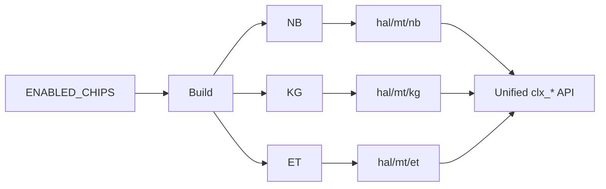

# 多芯片抽象

## 定义

SDK（Software Development Kit，软件开发工具包；把多代芯片差异封装成统一接口）用“统一 API（Application Programming Interface，应用编程接口；各芯片共用的 clx_* 函数集） + 分层 mt（按芯片型号分目录的特化层；存放 NB/KG/ET 差异实现）目录”支持多代交换芯片：NamchaBarwa（NB）、Kawagarbo（KG）、Everest（ET），API 文档标注 CLX84/86/88。

## 如何工作

- `config.mk`：`ENABLED_CHIPS := namchabarwa kawagarbo everest`。
- 芯片差异下沉三层：
  - `hal/mt/{nb,kg,et}`（HAL 层的芯片特化实现，存放功能语义差异）：功能语义差异。
  - `drv/mt/{nb,kg,et}`（DRV 层的芯片特化实现，处理 IO/DMA 等硬件差异）：IO/DMA 差异。
  - `tob/mt/{sram,tcam,hash,tbl}`（TOB 层按表项类型分路径，SRAM/TCAM/hash 各有访问实现）：表项访问差异。
- `clx_cfg.h`：`CLX_CFG_MAXIMUM_CHIPS_PER_SYSTEM = 2`、`CLX_CFG_MAXIMUM_CORES_PER_CHIP = 4`。
- 构建期通过 `ENABLED_CHIPS` 选择芯片；运行期通过 `unit`/`inst_idx` 区分实例。

## 架构图

## 关键细节

- 多芯片系统里，SDK 需要处理跨芯片的端口、LAG（Link Aggregation Group，链路聚合组，多链路捆绑；用于带宽叠加与冗余）、L2/L3（Layer 2/Layer 3，二层交换与三层路由；多播需统一索引空间）多播索引偏移。
- `clx_cfg` 提供端口 lane（高速链路的独立数据通道；用于映射端口与物理引脚）、polarity（差分极性，交换差分对正负；用于修正 PCB 走线）、L2/L3 表大小、DMA（Direct Memory Access，直接内存访问；硬件搬移表项与报文数据）队列、统计轮询等配置。
- `hal/mt/common` 放跨芯片公共逻辑，避免每个芯片重复实现。
- `mock`（模拟实现，用软件替身替代硬件；支持无硬件开发与单元测试）目录支持无硬件/单元测试。

## 在项目中的位置

- 所属项目：[[Clounix-SDK]]
- 相关子系统：[[Clounix-SDK-Layering]]、[[Clounix-SDK-HAL-TOB]]

## 相关概念

- [[Multi-Chip-Patterns]]
- [[Software-Interface]]

## 自检问题

- 三代芯片的差异分别落在 HAL、DRV、TOB 的哪些文件？
- 哪些逻辑应该放 `mt/common`，哪些必须 per-chip？
- 多芯片系统的索引偏移如何处理？
- 构建期选择 vs 运行期选择各有什么取舍？

## 概念速览

| 概念 | 是什么 | 使用场景 | 延伸 |
|---|---|---|---|
| SDK | 软件开发工具包 | 统一多代芯片接口 | 多芯片支持的核心是接口稳定、差异下沉 |
| API | 应用编程接口 | 各芯片共用的 clx_* 函数 | API 相同不代表行为完全一致，需靠 mt 层补齐 |
| mt | 芯片特化目录 | 存放 NB/KG/ET 差异实现 | 与 OSAL 的 OS 差异抽象正交，构建期按 ENABLED_CHIPS 选择 |
| HAL | 硬件抽象层 | 功能语义差异 | 芯片间语义差异优先放这里，而非 API 层 |
| DRV | 驱动层 | IO/DMA 差异 | 越贴近硬件，特化代码越难复用 |
| TOB | 表项操作抽象 | 表项访问差异 | SRAM/TCAM/hash 的访问路径在 tob/mt 分目录 |
| L2/L3 | 二层/三层转发 | 多播索引偏移 | 多芯片时需全局统一索引，避免各芯片重复占用 |
| LAG | 链路聚合组 | 跨芯片链路捆绑 | 成员跨芯片时需处理流量哈希与故障切换 |
| lane | 高速链路通道 | 端口与引脚映射 | lane 映射错误常表现为链路起不来或误码 |
| polarity | 差分极性 | 修正 PCB 走线 | 与 lane 映射一起配置，属于 SerDes 初始化常见项 |
| DMA | 直接内存访问 | 表项/报文搬移 | 多芯片下 DMA 队列需按实例隔离 |
| mock | 模拟实现 | 无硬件测试 | 适合 CI；但无法覆盖真实时序与硬件缺陷 |

## 来源

- `config.mk`
- `clx_sdk/src/hal/mt/`
- `clx_sdk/src/drv/mt/`
- `clx_sdk/src/tob/mt/`
