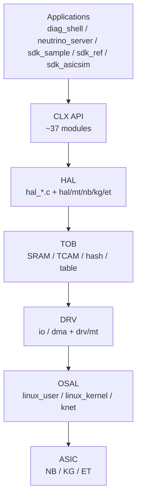

# Clounix SDK

## 一句话定位

Clounix 交换 ASIC（Application-Specific Integrated Circuit，专用集成电路；此处指交换芯片）的软件 SDK（Software Development Kit，软件开发工具包，封装芯片能力供上层调用；用于驱动、CLI 与业务应用）：把多代交换芯片的差异压进 HAL（Hardware Abstraction Layer，硬件抽象层；屏蔽不同芯片代际差异）/TOB（Table Operation Bus，表项操作抽象；统一各类表项的访问）/DRV（Driver，驱动层，负责寄存器 IO 与 DMA；直接与硬件交互）/OSAL（Operating System Abstraction Layer，操作系统抽象层；屏蔽 Linux 用户态/内核态差异），向上提供统一的 `clx_*` API（Application Programming Interface，应用编程接口；应用通过它调用 SDK）、CLI（Command-Line Interface，命令行接口；diag_shell 提供诊断命令）与 RPC。

## 架构骨架

- 芯片：NamchaBarwa（NB）、Kawagarbo（KG）、Everest（ET）；API 文档标注 CLX84/86/88
- 分层：CLX API → HAL → TOB → DRV → OSAL
- API：约 37 个模块（L2/L3/VLAN/MPLS/SRv6/TM/QoS/mirror/meter/LAG/BFD/PTP/telemetry/security/WLAN/VM/STP/SWC/netif/pkt/stat）
- 表项：TOB 抽象 SRAM（Static RAM，静态随机存储器；芯片内高速表项存储，如 MAC/路由表）/TCAM（Ternary Content-Addressable Memory，三态内容寻址存储器，支持掩码匹配；用于 ACL 与最长前缀匹配）/hash（哈希表，按键的哈希值定位存储位置；用于 MAC 表、ECMP 等查找）/table
- 系统：user/kernel 双空间、knet（Kernel Network，内核网络模块；打通 SDK 与 Linux 协议栈的数据通道）、eCPU（embedded CPU，芯片内置嵌入式处理器；运行固件处理控制/数据面任务）固件

## 架构图

## 关键子系统

- [[Clounix-SDK-Layering]]
- [[Clounix-SDK-HAL-TOB]]
- [[Clounix-SDK-MultiChip]]
- [[Clounix-SDK-eCPU]]

## 相关概念

- [[Software-Interface]]
- [[Multi-Chip-Patterns]]
- [[Cache-and-Memory]]（对照表项/缓存抽象）

## 学习阶段

- [[Stage-5-SDK]]

## 代码阅读路线

按“API 契约 → 一条完整调用链 → 逐层下沉 → 跨芯片对比 → 应用”的顺序读；路径相对 `source_repo`。不要从 `clx_sdk/src/` 第一行开始顺读，先抓住一条链。

1. **先看 API 契约** — `clx_sdk/include/clx/clx_l2.h`、`clx_sdk/src/clx/clx_l2.c`；最小使用方式看 `app/sdk_sample/sdk_sample_init.c`
   - 看：API 的参数、返回值、`Support_chip` 标注；应用初始化顺序。
   - 读完能回答：一个上层应用最少需要调用哪些 API 才能下发一条 L2 表项？
2. **跟一条 L2 调用链** — `clx_sdk/src/clx/clx_l2.c:clx_l2_addr_add` → `HAL_FUNC_CALL(unit, l2, addr_add, ...)` → `clx_sdk/src/hal/mt/<chip>/hal_mt_<chip>_l2.c:hal_mt_<chip>_l2_addr_add`；分发表看 `clx_sdk/src/hal/mt/<chip>/hal_mt_<chip>_drv.c`
   - 读完能回答：`HAL_FUNC_CALL` 如何在编译期/运行期选到具体芯片实现？
3. **看表项抽象 TOB** — `clx_sdk/src/tob/tob.c` 的 `tob_entry_write`/`tob_entry_read`、`tob_hash_entry_add`、`tob_dma_entry_write`；字段打包看 `clx_sdk/src/tob/tob_tbl.c` 的 `tob_tbl_*_pack`
   - 读完能回答：SRAM/TCAM/hash/direct 表在 TOB 里如何统一成 entry + field 操作？
4. **看驱动层 DRV** — `clx_sdk/src/drv/drv_io.c` 的 `drv_io_indir_entry_write`/`drv_io_indir_entry_read`、`clx_sdk/src/drv/drv_dma.c` 的 `drv_dma_entry_write`/`drv_dma_entry_read`
   - 读完能回答：间接表项访问与 DMA 批量访问分别适合什么场景？
5. **看 OS 抽象 OSAL** — `clx_sdk/src/osal/linux_user/osal.c`、`clx_sdk/src/osal/linux_kernel/`、`clx_sdk/src/osal/knet/`；构建变体看仓库根 `config.mk` 与 `clx_sdk/Makefile`
   - 读完能回答：同一份 SDK 如何构建成用户态 `.so` 与内核态 `.ko`？knet 在哪一层接入 Linux 协议栈？
6. **横向对比三代芯片** — `clx_sdk/src/hal/mt/nb/`、`clx_sdk/src/hal/mt/kg/`、`clx_sdk/src/hal/mt/et/` 中同名 `hal_mt_*_l2.c` 的实现差异
   - 读完能回答：哪些逻辑必须 per-chip 实现？哪些被 `clx_sdk/src/hal/hal_cmn.c` 抽走？
7. **最后看应用层** — `app/diag_shell/`（诊断 CLI）、`app/neutrino_server/`（RPC）；eCPU 路径看 `clx_sdk/src/hal/hal_ecpu.c`、`hal_ecpu_elink.c`、`hal_ecpu_ringbuffer.c` 与根目录 `ecpu_fw.mk`
   - 读完能回答：CLI、RPC、直接 API 三条路径最终如何汇到同一套 HAL/TOB？

## 实验记录

- [ ] 跟踪 `clx_l2_add` 到硬件表项的调用链
- [ ] 读 TOB 的 entry/bank/field 操作
- [ ] 比较 NB/KG/ET 的 `hal/mt` 差异
- [ ] 理解 user/kernel 两种构建

## 开放问题

- 37 个模块中，哪些是芯片无关的公共逻辑，哪些必须 per-chip 实现？
- TOB 如何屏蔽 SRAM/TCAM/hash 的访问差异？
- eCPU 固件与 host SDK 的职责边界在哪里？

## 概念速览

| 概念 | 是什么 | 使用场景 | 延伸 |
|---|---|---|---|
| ASIC | 专用集成电路 | 交换芯片本体 | 与通用 CPU 对比：ASIC 用硬件流水线换吞吐，灵活性靠 SDK 补足 |
| SDK | 软件开发工具包 | 封装芯片能力供应用调用 | SDK 不等于驱动：驱动贴近硬件，SDK 还含 API、CLI、RPC 等 |
| HAL | 硬件抽象层 | 屏蔽多代芯片差异 | 与 OSAL 分工：HAL 抽象硬件，OSAL 抽象操作系统 |
| TOB | 表项操作抽象 | 统一访问 SRAM/TCAM/hash | 位于 HAL 之下、DRV 之上，避免 HAL 直接拼寄存器 |
| DRV | 驱动层 | 寄存器 IO 与 DMA | 芯片差异也下沉到 drv/mt 目录 |
| OSAL | 操作系统抽象层 | 用户态/内核态统一接口 | 同一套 SDK 可构建为 .so 或 .ko |
| API | 应用编程接口 | 应用调用 clx_* 函数 | 约 37 个模块，覆盖 L2/L3/QoS 等 |
| CLI | 命令行接口 | diag_shell 诊断 | 适合排障；自动化通常走 API/RPC |
| SRAM | 静态随机存储器 | 高速表项存储 | 与 TCAM 对比：SRAM 精确匹配，TCAM 支持掩码 |
| TCAM | 三态内容寻址存储器 | ACL、最长前缀匹配 | 成本/功耗高，容量通常远小于 SRAM |
| hash | 哈希表 | MAC 表、ECMP 查找 | 冲突处理与老化机制决定表项容量和稳定性 |
| knet | 内核网络模块 | SDK 与 Linux 协议栈互通 | 常用于把报文上送内核或从内核注入芯片 |
| eCPU | 芯片内置嵌入式 CPU | 运行固件处理控制/数据面任务 | 与 host SDK 通过寄存器/表项/DMA 交互 |

## 来源

- `config.mk`
- `build.mk`
- `clx_sdk/Makefile`
- `clx_sdk/include/clx/`
- `clx_sdk/include/tob/tob.h`
