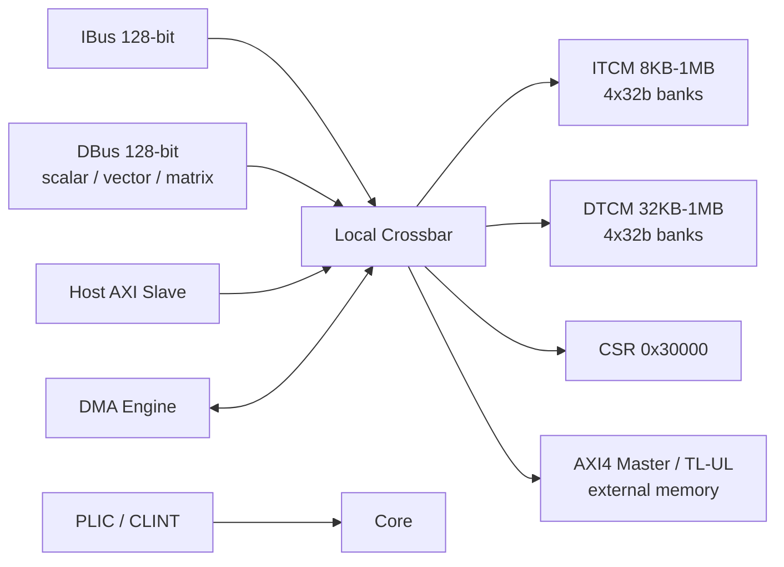

# CoralNPU 存储系统

## 定义

CoralNPU 使用 scratchpad（即 TCM，紧耦合存储器：软件管理的片上暂存存储，由软件显式控制数据搬运；用于确定性实时推理）而非 cache：ITCM（指令紧耦合存储器，片上单周期 SRAM，存放程序；用于无 cache 的确定性取指） 放指令，DTCM（数据紧耦合存储器，片上单周期 SRAM，存放数据与栈；用于低延迟确定性访问） 放数据，均为单周期 SRAM（静态随机存取存储器，无需刷新、可单周期访问；用于片上高速暂存）；外部通过 AXI4（ARM 的片上总线协议；用于 IP 与内存/外设的高带宽互联） 或 TileLink-UL（Rocket Chip 生态的无缓存轻量总线协议；用于低面积、低延迟的 IP 互联） 访问。

## 如何工作

- 默认：8KB ITCM + 32KB DTCM。
- Highmem：可配到 1MB ITCM / 1MB DTCM（或 512KB/512KB）。
- ITCM/DTCM 均为 4×32b bank（存储体，把 SRAM 分成多个可并行访问的块；用于缓解多端口访问冲突），带本地 crossbar（交叉开关，把多个主设备连接到多个从设备；用于并发访问路由）；DTCM 支持标量 LSU（加载/存储单元，执行标量与向量访存；用于访问 DTCM/外部内存）、向量、矩阵、外部 DMA（直接内存访问，外设绕过 CPU 搬运数据；用于批量 1D/2D 数据搬运）/host 并发访问。
- 地址映射：
  - ITCM `0x0000_0000`
  - DTCM `0x0001_0000`
  - CSR `0x0003_0000`
- 外部接口：128-bit AXI4 master（LSU/取指 fallback）、128-bit AXI4 slave（host 写 TCM/CSR）、TL-UL 变体。
- DMA：多通道 2D/1D，外部内存 ↔ TCM。
- 中断：PLIC（Platform-Level Interrupt Controller，平台级中断控制器，汇聚外设中断并分发给核；用于外部中断管理） + CLINT（Core-Local Interruptor，核本地中断器，处理定时器与软件中断；用于定时/核间事件）；调试：RISC-V Debug Module。

## 架构图

## 关键细节

- 无 cache 层次，因此没有 cache 一致性协议；单核 TSO（Total Store Order，总存储顺序内存模型；用于简化单核内存序语义），`FENCE` 在硬件中当 NOP，`FENCE.I` 负责 drain store 并 flush fetch。
- 外部总线故障（DTCM 访问越界、ITCM 写、slave error）触发精确 trap。
- host 启动流程：写 ITCM → 写 start PC → 解时钟门控/复位 → 轮询 halted。

## 在项目中的位置

- 所属项目：[[CoralNPU]]
- 相关子系统：[[CoralNPU-Pipeline]]、[[CoralNPU-RVV]]、[[CoralNPU-VME]]

## 相关概念

- [[Scratchpad-and-TCM]]
- [[Cache-and-Memory]]

## 自检问题

- 为什么 scratchpad 比 cache 更适合确定性推理？
- 4 个 bank 如何服务标量/向量/矩阵/DMA 的并发访问？
- AXI slave 与 AXI master 各自的使用场景？
- highmem 配置对地址映射有什么影响？

## 概念速览

| 概念 | 是什么 | 使用场景 | 延伸 |
|---|---|---|---|
| scratchpad | 软件管理的片上暂存存储器 | 确定性实时推理 | 与 cache 对比：无标签/替换，延迟可预测 |
| TCM | 紧耦合存储器 | 低延迟指令/数据访问 | 与 cache 对比：软件显式管理，无一致性开销 |
| ITCM | 指令紧耦合存储器 | 无 cache 的确定性取指 | 默认 8KB，highmem 可到 1MB |
| DTCM | 数据紧耦合存储器 | 标量/向量/矩阵/DMA 的数据暂存 | 默认 32KB，支持多主设备并发 |
| SRAM | 静态随机存取存储器 | 片上高速暂存 | 与 DRAM 对比：快、贵、无需刷新 |
| AXI4 | ARM 的片上总线协议 | IP 与内存/外设的高带宽互联 | 128-bit master/slave，支持 burst |
| TileLink-UL | 无缓存轻量级片上总线协议 | 低面积、低延迟的 IP 互联 | TL-UL 变体与 AXI4 二选一 |
| bank | 存储体，SRAM 的并行分块 | 缓解多端口访问冲突 | 4×32b bank；地址映射不当会 bank 冲突 |
| crossbar | 交叉开关 | 多主多从的并发访问路由 | 本地 crossbar 连接 ITCM/DTCM/CSR/外部总线 |
| LSU | 加载/存储单元 | 标量与向量访存 | DTCM 需同时服务 LSU、向量、矩阵与 DMA |
| DMA | 直接内存访问 | 批量 1D/2D 数据搬运 | 绕过 CPU，适合 tile/张量流式加载 |
| PLIC | 平台级中断控制器 | 外设中断汇聚与分发 | 与 CLINT 分工：外部中断 vs 定时/软件中断 |
| CLINT | 核本地中断器 | 定时器与软件中断 | RISC-V 标准的中断/定时组件 |
| TSO | 总存储顺序内存模型 | 单核内存序语义 | 无 cache 时 FENCE 可为 NOP，FENCE.I 仍需 drain/flush |

## 来源

- `doc/overview.md`
- `doc/integration_guide.md`
- `doc/microarch/lsu.md`
