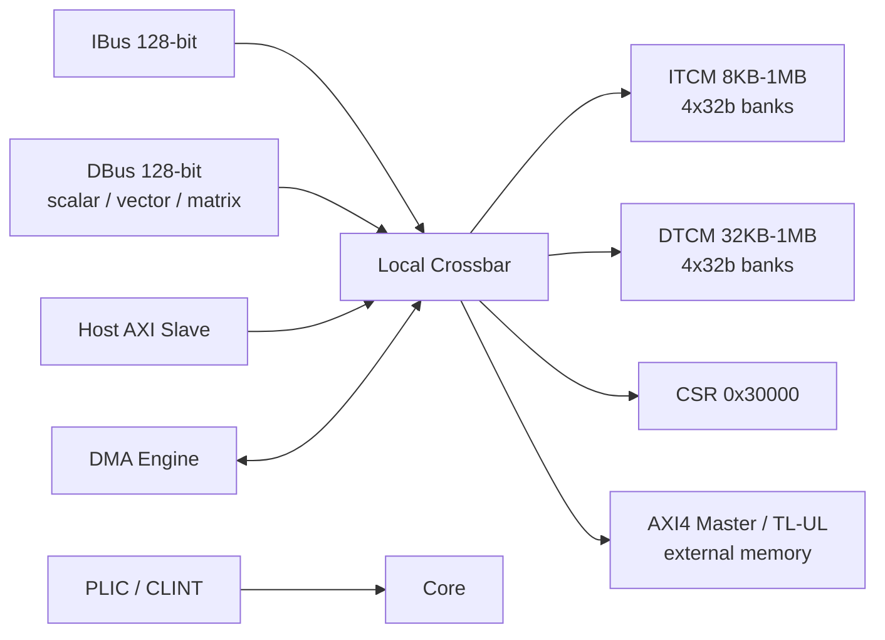

# CoralNPU 存储系统

## 定义

CoralNPU 使用 scratchpad（TCM）而非 cache：ITCM 放指令，DTCM 放数据，均为单周期 SRAM；外部通过 AXI4 或 TileLink-UL 访问。

## 如何工作

- 默认：8KB ITCM + 32KB DTCM。
- Highmem：可配到 1MB ITCM / 1MB DTCM（或 512KB/512KB）。
- ITCM/DTCM 均为 4×32b bank，带本地 crossbar；DTCM 支持标量 LSU、向量、矩阵、外部 DMA/host 并发访问。
- 地址映射：
  - ITCM `0x0000_0000`
  - DTCM `0x0001_0000`
  - CSR `0x0003_0000`
- 外部接口：128-bit AXI4 master（LSU/取指 fallback）、128-bit AXI4 slave（host 写 TCM/CSR）、TL-UL 变体。
- DMA：多通道 2D/1D，外部内存 ↔ TCM。
- 中断：PLIC + CLINT；调试：RISC-V Debug Module。

## 架构图

## 关键细节

- 无 cache 层次，因此没有 cache 一致性协议；单核 TSO，`FENCE` 在硬件中当 NOP，`FENCE.I` 负责 drain store 并 flush fetch。
- 外部总线故障（DTCM 访问越界、ITCM 写、slave error）触发精确 trap。
- host 启动流程：写 ITCM → 写 start PC → 解时钟门控/复位 → 轮询 halted。

## 在项目中的位置

- 所属项目：[[CoralNPU]]
- 相关子系统：[[CoralNPU-Pipeline]]、[[CoralNPU-RVV]]、[[CoralNPU-VME]]

## 相关概念

- [[Scratchpad-and-TCM]]
- [[Cache-and-Memory]]

## 自检问题

- 为什么 scratchpad 比 cache 更适合确定性推理？
- 4 个 bank 如何服务标量/向量/矩阵/DMA 的并发访问？
- AXI slave 与 AXI master 各自的使用场景？
- highmem 配置对地址映射有什么影响？

## 来源

- `doc/overview.md`
- `doc/integration_guide.md`
- `doc/microarch/lsu.md`
