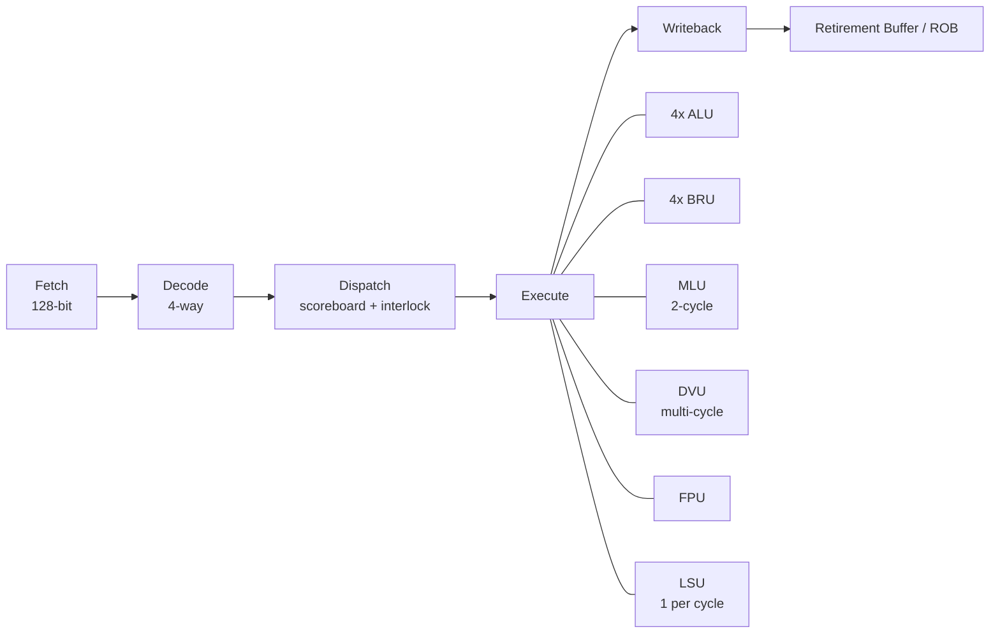

# CoralNPU 标量流水线

## 定义

CoralNPU 标量核是 4 宽、顺序派发的前端：每个周期最多从指令缓冲中取 4 条指令，经 scoreboard（记分板，跟踪寄存器读写依赖与就绪状态；用于派发前的冒险判断） 判断依赖后派发到 ALU（算术逻辑单元，执行整数加减与逻辑运算；用于通用整数计算）/BRU（分支处理单元，解析并执行分支/跳转；用于控制流）/MLU（乘法单元，执行整数乘法；用于乘加类负载）/DVU（除法单元，执行整数除法与取余；用于除法运算）/FPU（浮点运算单元，执行 FP32/BF16 运算；用于浮点负载）/LSU（加载/存储单元，处理访存指令；用于 load/store 与向量访存）。

## 如何工作

```text
Fetch (128-bit) → Decode/Dispatch (4-way) → Execute/Writeback → Retirement Buffer
```

- 4 个 ALU、4 个 BRU：每周期可服务 4 条整数/分支指令。
- 1 个 MLU：3 级流水，每周期最多 1 条乘法。
- 1 个 DVU：多周期，非流水，忙时反压派发。
- 1 个 FPU：多周期流水。
- LSU：每周期最多 1 条内存指令。
- Scoreboard：跟踪 RAW/WAW（读后写/写后写数据冒险，后续指令依赖前序结果；用于依赖判断与旁路控制）；所有单元在派发后下一周期读寄存器，因此不会出现 WAR（写后读冒险，后序写覆盖前序读；靠“先读操作数、后写回”的时序避免）。

## 架构图



## 关键细节

- 文档口径：`microarch.md` 写 3 级流水，README 写 4 级；以 RTL（Register Transfer Level，寄存器传输级硬件描述；用于与文档口径核对） 为准。
- 文档对 retire（退休/提交，把指令结果永久写入架构状态；用于顺序语义与精确异常） 的表述也不完全统一：`overview.md` 说 in-order retirement，README 说 out-of-order retire；实际以 ROB（重排序缓冲，在飞指令按序提交；用于乱序/多周期执行核） /RetirementBuffer 的 RTL 行为为准。
- 控制流：不越过 `jal/jalr/ebreak/ecall/mret/wfi` 派发。
- 特殊指令（CSR，控制和状态寄存器，配置特权级、异常与性能计数等；用于系统控制；以及 fence、wfi 等）限制在 slot 0，且通常与跳转一样处理。

## 在项目中的位置

- 所属项目：[[CoralNPU]]
- 相关子系统：[[CoralNPU-RVV]]、[[CoralNPU-Memory]]

## 相关概念

- [[Pipeline-and-Hazards]]
- [[ISA-and-Extensions]]

## 自检问题

- 一条 `lw` 在 LSU 里经历哪些状态？
- 多周期 MLU/DVU 如何回写？WAR 为什么不会发生？
- CSR 指令为什么限制在 slot 0？
- 分支冲刷时，ROB 如何处理年轻指令？

## 概念速览

| 概念 | 是什么 | 使用场景 | 延伸 |
|---|---|---|---|
| scoreboard | 记分板，跟踪寄存器依赖与就绪状态 | 派发/发射前的冒险判断 | CoralNPU 的 scoreboard 还兼做 interlock，无需完整 OoO |
| ALU | 算术逻辑单元 | 整数加减、逻辑与移位 | 4 宽派发需要 4 个 ALU 才能每周期吃满 |
| BRU | 分支处理单元 | 分支、跳转与比较 | 4 个 BRU 说明分支吞吐被重点优化 |
| MLU | 乘法单元 | 整数乘法 | 3 级流水、每周期 1 条，与 ALU 的吞吐不同 |
| DVU | 除法单元 | 整数除法与取余 | 多周期非流水，忙时会反压派发 |
| FPU | 浮点运算单元 | FP32/BF16 运算 | 与 MLU/DVU 同属多周期执行单元 |
| LSU | 加载/存储单元 | load/store 与向量访存 | 每周期 1 条，是访存带宽的瓶颈点 |
| RAW/WAW | 读后写/写后写数据冒险 | 依赖判断与旁路 | WAR 被“先读操作数、后写回”的时序天然规避 |
| WAR | 写后读冒险 | 寄存器复用场景 | 与 RAW 不同，WAR 可通过重命名或时序消除 |
| RTL | 寄存器传输级硬件描述 | 与文档口径核对 | 文档 3/4 级流水不一致时以 RTL 为准 |
| retire | 退休/提交 | 顺序语义与精确异常 | CoralNPU 文档对 in-order/out-of-order retire 的表述冲突 |
| ROB | 重排序缓冲 | 乱序/多周期执行核的顺序提交 | RetirementBuffer 与 ROB 是同一机制的不同叫法 |
| CSR | 控制和状态寄存器 | 特权级、异常与性能计数 | 特殊指令被限制在 slot 0，以简化派发逻辑 |

## 来源

- `doc/microarch/microarch.md`
- `doc/microarch/dispatch.md`
- `doc/microarch/mlu.md`
