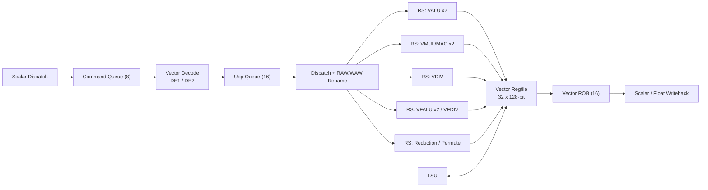

# CoralNPU RVV 后端

## 定义

RVV 1.0 解耦向量后端：标量前端把向量指令作为“命令”派发到独立后端，后端自行译码、乱序执行、顺序退休。

## 如何工作

```text
标量派发 → Command Queue (8) → 2 级向量译码 → Uop Queue (16)
         → Reservation Stations → VALU/VMUL/VDIV/VFALU/VFDIV/Reduction
         → Vector Regfile (32 × 128-bit) → Vector ROB (16) → 标量写回
```

- VLEN=128，32 个向量寄存器 `v0`–`v31`。
- SEW = 8/16/32；LMUL = 1/8、1/4、1/2、1、2、4、8。
- 执行单元：2× VALU、2× VMUL/MAC、1× VDIV、2× VFALU、1× VFDIV、1× Reduction/Permute。
- VROB 16 项，保证精确异常与顺序退休；支持异步写回标量/浮点寄存器（`vfmv.f.s`、reduction、`vsetvl`）。

## 架构图



## 关键细节

- LSU 支持 unit-stride、strided、ordered/unordered indexed（gather/scatter）、masked、fault-only-first（`vle8ff.v`）。
- 向量内存操作在 LSU 中走 `rvv2lsu` 接口；按 16B 行合并，ordered indexed 走 strict 模式。
- `vstart` 用于精确异常时定位失败元素。
- BF16：`vfwmaccbf16.vv`、`vfwcvtbf16`、`vfncvtbf16`。

## 在项目中的位置

- 所属项目：[[CoralNPU]]
- 相关子系统：[[CoralNPU-Pipeline]]、[[CoralNPU-VME]]、[[CoralNPU-Memory]]

## 相关概念

- [[Vector-Architecture]]
- [[Pipeline-and-Hazards]]

## 自检问题

- 向量指令为什么需要独立的 VROB？
- `vstart` 在精确异常里起什么作用？
- LMUL 如何影响寄存器分组与 LSU 的访问模式？
- ordered indexed 为什么要 strict 模式？

## 来源

- `doc/overview.md`
- `hdl/verilog/rvv/design/`
- `tests/cocotb/rvv/`
