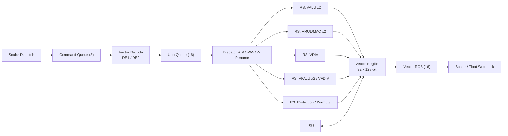

# CoralNPU RVV 后端

## 定义

RVV（RISC-V Vector Extension，向量扩展；用于 ML、DSP、图像处理等数据并行负载） 1.0 解耦向量后端：标量前端把向量指令作为“命令”派发到独立后端，后端自行译码、乱序执行、顺序退休。

## 如何工作

```text
标量派发 → Command Queue (8) → 2 级向量译码 → Uop Queue (16)
         → Reservation Stations → VALU/VMUL/VDIV/VFALU/VFDIV/Reduction
         → Vector Regfile (32 × 128-bit) → Vector ROB (16) → 标量写回
```

- VLEN（向量长度，单个向量寄存器的位宽；决定向量指令一次处理的数据宽度）=128，32 个向量寄存器 `v0`–`v31`。
- SEW（元素宽度，每个向量元素的位宽；用于选择 int8/int16/int32 等数据类型） = 8/16/32；LMUL（向量长度乘数，把多个向量寄存器组合成一个逻辑向量；用于平衡寄存器压力与并行度） = 1/8、1/4、1/2、1、2、4、8。
- 执行单元：2× VALU（向量算术逻辑单元，执行整数向量加减与逻辑运算；用于逐元素整数计算）、2× VMUL/MAC（向量乘法/乘加单元，执行乘与乘累加；用于点积与卷积）、1× VDIV、2× VFALU（向量浮点算术单元，执行 FP32/BF16 向量运算；用于浮点逐元素计算）、1× VFDIV、1× Reduction/Permute。
- VROB（向量重排序缓冲，保证向量指令顺序退休与精确异常；用于解耦向量后端） 16 项，保证精确异常与顺序退休；支持异步写回标量/浮点寄存器（`vfmv.f.s`、reduction、`vsetvl` 等；其中 `vsetvl` 配置向量长度、SEW 与 LMUL，用于向量循环的动态控制）。

## 架构图



## 关键细节

- LSU（加载/存储单元，处理向量与标量访存；用于与 DTCM/外部内存交互） 支持 unit-stride、strided、ordered/unordered indexed（即 gather/scatter：索引收集/散布，按索引向量逐元素访问内存；用于稀疏、间接访存）、masked、fault-only-first（`vle8ff.v`）。
- 向量内存操作在 LSU 中走 `rvv2lsu` 接口；按 16B 行合并，ordered indexed 走 strict 模式。
- `vstart`（向量起始元素索引，记录异常时失败的元素位置；用于异常后从失败元素恢复） 用于精确异常时定位失败元素。
- BF16（Brain Floating Point 16，16 位浮点格式；用于训练/推理中兼顾动态范围与吞吐）：`vfwmaccbf16.vv`、`vfwcvtbf16`、`vfncvtbf16`。

## 在项目中的位置

- 所属项目：[[CoralNPU]]
- 相关子系统：[[CoralNPU-Pipeline]]、[[CoralNPU-VME]]、[[CoralNPU-Memory]]

## 相关概念

- [[Vector-Architecture]]
- [[Pipeline-and-Hazards]]

## 自检问题

- 向量指令为什么需要独立的 VROB？
- `vstart` 在精确异常里起什么作用？
- LMUL 如何影响寄存器分组与 LSU 的访问模式？
- ordered indexed 为什么要 strict 模式？

## 概念速览

| 概念 | 是什么 | 使用场景 | 延伸 |
|---|---|---|---|
| RVV | RISC-V Vector Extension，向量扩展 | ML、DSP、图像处理等数据并行 | CoralNPU 实现 RVV 1.0，采用解耦后端 |
| VLEN | 向量长度，单个向量寄存器的位宽 | 决定一次处理的数据宽度 | VLEN=128，与 SEW、LMUL 共同决定分组 |
| SEW | 元素宽度 | 选择 int8/int16/int32 及浮点元素类型 | SEW×LMUL 决定寄存器内元素个数 |
| LMUL | 向量长度乘数 | 平衡寄存器压力与并行度 | LMUL>1 时多个寄存器组成一个逻辑向量 |
| VALU | 向量算术逻辑单元 | 逐元素整数加减与逻辑 | 2 个 VALU 支撑多发射 |
| VMUL/MAC | 向量乘法/乘加单元 | 点积、卷积等乘加密集计算 | MAC 是 GEMM 与卷积的原子操作 |
| VFALU | 向量浮点算术单元 | FP32/BF16 逐元素浮点运算 | 与标量 FPU 共享浮点数据通路 |
| VROB | 向量重排序缓冲 | 解耦向量后端的顺序退休与精确异常 | 独立于标量 ROB，通过写回与标量同步 |
| vsetvl | 配置向量长度、SEW、LMUL 的指令 | 向量循环的动态控制 | 与 vtype CSR 配合，影响后续向量指令语义 |
| LSU | 加载/存储单元 | 向量 load/store 与 gather/scatter | 向量访存按 16B 行合并，降低事务数 |
| gather/scatter | 索引收集/散布访存 | 稀疏、间接、查表类访问 | ordered indexed 需 strict 模式保证顺序 |
| vstart | 向量起始元素索引 | 精确异常后从失败元素恢复 | 也用于分段执行长向量 |
| BF16 | Brain Floating Point 16 | 训练/推理中的浮点计算 | 与 FP16 对比：指数位更多、尾数更少 |

## 来源

- `doc/overview.md`
- `hdl/verilog/rvv/design/`
- `tests/cocotb/rvv/`
