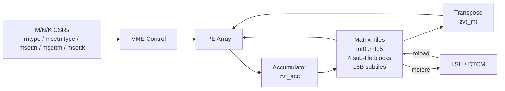

# CoralNPU VME / Zvt 矩阵扩展

## 定义

VME（Vector Matrix Extension，向量矩阵扩展；用于在 RVV 之外增加矩阵乘能力）/ Zvt（RISC-V 矩阵扩展的指令集命名；用于矩阵 tile 与 GEMM 指令） 是 CoralNPU 中实验性的矩阵扩展：在 RVV（RISC-V Vector Extension，向量扩展；用于数据并行向量计算） 之外增加 matrix tile（矩阵分块寄存器，保存一整块矩阵数据；用于 PE 阵列的输入与累加） 状态与 PE（Processing Element，处理单元，阵列中执行乘加的基本单元；用于并行矩阵计算） 阵列，用于 INT8/FP32/BF16（Brain Floating Point 16，16 位浮点格式；用于兼顾动态范围与吞吐的矩阵计算） GEMM（通用矩阵乘法，全连接与卷积的核心计算；用于 AI 推理与训练）。

## 如何工作

- 16 个 matrix tile 寄存器 `mt0`–`mt15`。
- 每个 tile 映射到 4 个 sub-tile block，sub-tile 为 16B。
- 配置 CSR（控制和状态寄存器，保存矩阵类型与 M/N/K 等配置；用于控制矩阵指令行为）/指令：`mtype`、`msetmtype`、`msetmtypei`、`msettn`、`msettm`、`msettk`，配置 M/N/K 与数据类型。
- PE 阵列执行 outer-product（外积，一列乘一行得到秩 1 矩阵；GEMM 的微内核基本形式） / GEMM。
- 硬件 accumulator（累加器，跨 K 维累加部分和；用于矩阵乘的数据复用）（`zvt_acc`）与 transpose（`zvt_mt`）。
- `mload`/`mstore` 直接与 LSU（加载/存储单元，执行 tile 的加载与写回；用于矩阵与内存间搬运）/DTCM（数据紧耦合存储器，片上单周期 SRAM；用于 tile 数据暂存） 耦合，2D tile 流式加载/写回。

## 架构图

## 关键细节

- 支持 INT8、FP32、BF16。
- 与 RVV 共享 LSU/DTCM 通路，tile 的 bank/布局会直接影响带宽。
- 文档明确标注 experimental/optional；成熟度低于 TCU（Tensor Compute Unit，张量计算单元，Vortex 的矩阵/张量核；用于对比矩阵扩展成熟度）（Vortex）。

## 在项目中的位置

- 所属项目：[[CoralNPU]]
- 相关子系统：[[CoralNPU-RVV]]、[[CoralNPU-Memory]]

## 相关概念

- [[Matrix-Accelerator]]
- [[Scratchpad-and-TCM]]

## 自检问题

- tile 的 M/N/K 如何映射到 PE 阵列？
- `mload/mstore` 与普通向量 load/store 的差异是什么？
- 为什么矩阵引擎需要独立的 accumulator/transpose？
- 16 个 tile 如何避免与 DTCM bank 冲突？

## 概念速览

| 概念 | 是什么 | 使用场景 | 延伸 |
|---|---|---|---|
| VME | Vector Matrix Extension，向量矩阵扩展 | 在 RVV 之外做矩阵乘加速 | CoralNPU 中为实验性、可选部件 |
| Zvt | RISC-V 矩阵扩展的指令集命名 | 矩阵 tile 与 GEMM 指令 | 与 VME 硬件一起出现，文档常合称 VME/Zvt |
| RVV | RISC-V Vector Extension，向量扩展 | 数据并行向量计算 | VME 复用 RVV 的 LSU/DTCM 通路 |
| PE | Processing Element，处理单元 | 阵列中并行执行乘加 | 多个 PE 组成 outer-product/GEMM 阵列 |
| GEMM | 通用矩阵乘法 | 全连接、卷积等 DNN 计算 | 受 M/N/K 尺寸与存储带宽共同约束 |
| BF16 | Brain Floating Point 16 | 兼顾范围与吞吐的矩阵计算 | 与 INT8/FP32 并列作为 VME 支持的数据类型 |
| tile | 矩阵分块寄存器 | 保存矩阵输入与累加结果 | 每个 tile 映射到 4 个 16B sub-tile block |
| CSR | 控制和状态寄存器 | 保存 mtype 与 M/N/K 配置 | msetmtype/msettn/msettm/msettk 属于配置指令 |
| outer-product | 外积，秩 1 矩阵更新 | GEMM 的微内核基本形式 | 与 inner-product 对比：更利于数据复用 |
| accumulator | 累加器 | 跨 K 维累加部分和 | zvt_acc 是硬件累加状态，可减少写回 |
| LSU | 加载/存储单元 | mload/mstore 与内存搬运 | 与 RVV 共享，tile 布局会影响带宽 |
| DTCM | 数据紧耦合存储器 | tile 数据暂存 | 4×32b bank，tile 映射不当会 bank 冲突 |
| TCU | Tensor Compute Unit，张量计算单元 | Vortex 的矩阵/张量加速 | 成熟度高于 CoralNPU 的 VME，可作对照 |

## 来源

- `doc/overview.md`
- `hdl/verilog/rvv/design/Zvt/`
- `tests/cocotb/vme_test/`
