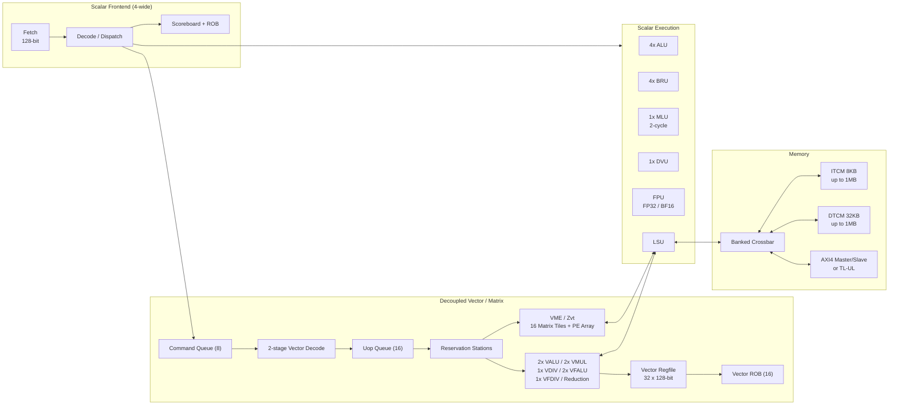

# CoralNPU

## 一句话定位

Google Research 开源的 RISC-V 边缘 ML NPU IP，面向可穿戴设备；标量、向量（RVV）、矩阵（VME/Zvt）三个部件协同。

## 架构骨架

- ISA：`rv32imf_zve32x_zicsr_zifencei_zbb`，可选 RVV 1.0（`Zve32f`、`Zvfbfmin`）
- 标量：4 宽顺序派发，4 ALU + 4 BRU + 1 MLU + 1 DVU + FPU
- 向量：VLEN=128，32 个向量寄存器，解耦执行，16 项 VROB
- 矩阵：实验性 VME/Zvt，16 个 matrix tile，INT8/FP32/BF16 GEMM
- 存储：8KB ITCM + 32KB DTCM（可配到 1MB/1MB），无 cache
- 总线：AXI4 master/slave 或 TileLink-UL

## 架构图

## 关键子系统

- [[CoralNPU-Pipeline]]
- [[CoralNPU-RVV]]
- [[CoralNPU-VME]]
- [[CoralNPU-Memory]]
- [[CoralNPU-Verification]]

## 相关概念

- [[Pipeline-and-Hazards]]
- [[Vector-Architecture]]
- [[Matrix-Accelerator]]
- [[Scratchpad-and-TCM]]
- [[Verification-Fidelity]]

## 学习阶段

- [[Stage-1-Scalar-Core]]
- [[Stage-2-RVV-VME]]

## 代码入口

- `doc/overview.md`
- `doc/microarch/`
- `hdl/chisel/src/coralnpu/scalar/`
- `hdl/verilog/rvv/design/`
- `hdl/verilog/rvv/design/Zvt/`
- `tests/cocotb/`
- `tests/uvm/`

## 实验记录

- [ ] 跑通 `core_mini_verification_axi_sim` + `--instr_trace`
- [ ] 手画 `load` 指令路径
- [ ] 加一个 CSR 并通过 cocotb
- [ ] 跑 RVV intrinsic 示例
- [ ] 观察 VME tile 映射

## 开放问题

- VME 的 tile 布局如何避免 DTCM bank conflict？
- 解耦向量后端的 OoO 执行如何保证精确异常？
- 文档中 3 级/4 级流水、in-order/out-of-order retire 的口径差异，以哪份 RTL 为准？

## 来源

- `README.md`
- `doc/overview.md`
- `doc/microarch/microarch.md`
- `doc/integration_guide.md`
