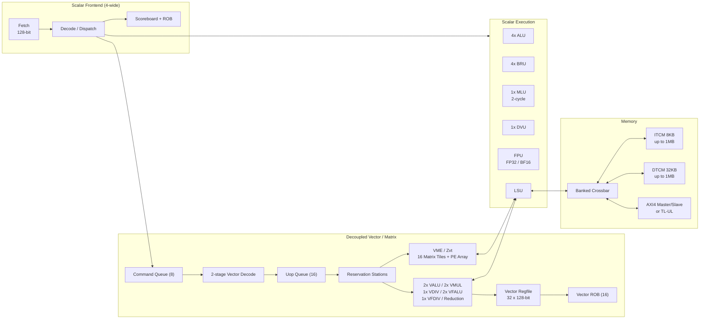

# CoralNPU

## 一句话定位

Google Research 开源的 RISC-V（开放、模块化的指令集架构；广泛用于 MCU、AI 加速器、边缘 NPU 与服务器） 边缘 ML NPU（神经网络处理器，面向神经网络的专用推理加速器；用于可穿戴、边缘设备的低功耗推理） IP，面向可穿戴设备；标量、向量（RVV，RISC-V Vector Extension：向量扩展；用于 ML、DSP、图像处理等数据并行负载）、矩阵（VME/Zvt，Vector Matrix Extension：向量矩阵扩展；用于 INT8/FP32/BF16 矩阵乘加速）三个部件协同。

## 架构骨架

- ISA（指令集架构，软件与硬件的契约；用于定义指令编码、寄存器与特权模型）：`rv32imf_zve32x_zicsr_zifencei_zbb`，可选 RVV 1.0（`Zve32f`、`Zvfbfmin`）
- 标量：4 宽顺序派发，4 ALU + 4 BRU + 1 MLU + 1 DVU + FPU（浮点运算单元；用于 FP32/BF16 等浮点计算）
- 向量：VLEN（向量长度，单个向量寄存器的位宽；决定向量指令一次处理的数据宽度）=128，32 个向量寄存器，解耦执行，16 项 VROB（向量重排序缓冲，保证向量指令顺序退休与精确异常；用于解耦向量后端）
- 矩阵：实验性 VME/Zvt，16 个 matrix tile，INT8/FP32/BF16（Brain Floating Point 16，16 位浮点格式；用于训练/推理中兼顾动态范围与吞吐） GEMM（通用矩阵乘法，全连接与卷积的核心计算；用于 AI 推理与训练）
- 存储：8KB ITCM（指令紧耦合存储器，片上单周期 SRAM，存放程序；用于无 cache 的确定性取指） + 32KB DTCM（数据紧耦合存储器，片上单周期 SRAM，存放数据与栈；用于低延迟确定性访问）（可配到 1MB/1MB），无 cache
- 总线：AXI4（ARM 的片上总线协议；用于 IP 与内存/外设的高带宽互联） master/slave 或 TileLink-UL（Rocket Chip 生态的无缓存轻量总线协议；用于低面积、低延迟的 IP 互联）

## 架构图

## 关键子系统

- [[CoralNPU-Pipeline]]
- [[CoralNPU-RVV]]
- [[CoralNPU-VME]]
- [[CoralNPU-Memory]]
- [[CoralNPU-Verification]]

## 相关概念

- [[Pipeline-and-Hazards]]
- [[Vector-Architecture]]
- [[Matrix-Accelerator]]
- [[Scratchpad-and-TCM]]
- [[Verification-Fidelity]]

## 学习阶段

- [[Stage-1-Scalar-Core]]
- [[Stage-2-RVV-VME]]

## 代码入口

- `doc/overview.md`
- `doc/microarch/`
- `hdl/chisel/src/coralnpu/scalar/`
- `hdl/verilog/rvv/design/`
- `hdl/verilog/rvv/design/Zvt/`
- `tests/cocotb/`
- `tests/uvm/`

## 实验记录

- [ ] 跑通 `core_mini_verification_axi_sim` + `--instr_trace`
- [ ] 手画 `load` 指令路径
- [ ] 加一个 CSR 并通过 cocotb
- [ ] 跑 RVV intrinsic 示例
- [ ] 观察 VME tile 映射

## 开放问题

- VME 的 tile 布局如何避免 DTCM bank conflict？
- 解耦向量后端的 OoO 执行如何保证精确异常？
- 文档中 3 级/4 级流水、in-order/out-of-order retire 的口径差异，以哪份 RTL 为准？

## 概念速览

| 概念 | 是什么 | 使用场景 | 延伸 |
|---|---|---|---|
| RISC-V | 开放、模块化的指令集架构 | MCU、AI 加速器、边缘 NPU | 与 ARM/x86 对比：免授权费、可裁剪、生态较新 |
| NPU | 面向神经网络的专用推理加速器 | 可穿戴、边缘设备的低功耗推理 | 与 GPU/DSP 对比：能效更高但通用性较弱 |
| RVV | RISC-V Vector Extension，向量扩展 | ML、DSP、图像处理等数据并行负载 | CoralNPU 采用 RVV 1.0，VLEN=128 |
| VME/Zvt | CoralNPU 实验性的矩阵扩展 | INT8/FP32/BF16 GEMM | 成熟度低于 Vortex 的 TCU，文档标注 optional |
| ISA | 指令集架构，软硬件契约 | 定义指令编码、寄存器与特权模型 | 长 ISA 字符串可拆解为 base + 扩展，便于核对 |
| FPU | 浮点运算单元 | FP32/BF16 等浮点计算 | 与定点 ALU 对比：动态范围大、面积与功耗更高 |
| VLEN | 向量长度，单个向量寄存器的位宽 | 决定向量指令一次处理的数据宽度 | 与 SEW、LMUL 共同决定向量寄存器分组 |
| VROB | 向量重排序缓冲 | 解耦向量后端的顺序退休与精确异常 | 标量 ROB 与 VROB 通过命令队列和写回协同 |
| GEMM | 通用矩阵乘法 | 全连接、卷积等 DNN 核心计算 | 矩阵扩展的典型基准，受 M/N/K 与存储带宽约束 |
| BF16 | Brain Floating Point 16，16 位浮点格式 | 训练/推理中兼顾动态范围与吞吐 | 与 FP16 对比：指数位更多、尾数精度更低 |
| ITCM | 指令紧耦合存储器 | 无 cache 的确定性取指 | 容量小、单周期；与 DTCM 共享本地 crossbar |
| DTCM | 数据紧耦合存储器 | 标量/向量/矩阵/DMA 的数据暂存 | 4×32b bank；bank 冲突会直接影响带宽 |
| AXI4 | ARM 的片上总线协议 | IP 与内存/外设的高带宽互联 | 支持 burst 与 outstanding；与 TileLink 是竞争方案 |
| TileLink-UL | 无缓存轻量级片上总线协议 | 低面积、低延迟的 IP 互联 | TL-UL 是 TileLink 的简化子集，常见于 Rocket Chip 生态 |

## 来源

- `README.md`
- `doc/overview.md`
- `doc/microarch/microarch.md`
- `doc/integration_guide.md`
