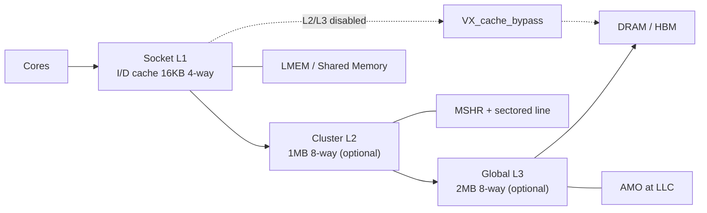

# Vortex 存储层次

## 定义

Vortex 有完整的 GPU cache 层次：L1（icache/dcache）、L2、L3、共享 LMEM（local memory，片上共享暂存内存，即 shared memory；warp 间数据交换与复用），以及可选的虚拟内存/TLB（translation lookaside buffer，页表项缓存，加速虚拟地址到物理地址转换；GPU 虚拟内存）。

## 如何工作

```text
core → socket (L1) → cluster (L2) → L3 → memory
```

- L1 位于 socket（插槽，封装多个 core 的物理单元；共享 L1 的多核组织）内，由最多 `SOCKET_SIZE` 个 core 共享；`VX_mem_unit` 只暴露 `dcache_bus_if`，不实例化 cache。
- 默认：icache/dcache 16KB 4-way；L2 1MB 8-way；L3 2MB 8-way。
- L2/L3 默认关闭；关闭时通过 `VX_cache_bypass` 透传，不是条件实例化。
- 非阻塞 cache：每 bank（存储体，可并行访问的独立存储阵列；多 lane 访存）一个 MSHR（miss status holding register，跟踪未完成 cache miss；乱序访存与请求合并），支持 fill forwarding（miss 数据返回时直接转发给等待请求；减少流水线停顿）。
- sectored line（分扇区缓存行，缓存行按扇区独立填充；降低 tag 开销与填充带宽）：tag（缓存行标签，记录地址高位与状态；命中判断）与 fill 粒度解耦（L2/L3）。
- AMO（atomic memory operation，原子读改写；全局计数器、锁、归约）只在 LLC（last-level cache，末级缓存，全 GPU 共享；AMO 与一致性汇聚点）执行；上层透传。
- LLC 判定：`DCACHE_IS_LLC = !L2 && !L3`；`L2_IS_LLC = L2 && !L3`；`L3_IS_LLC = L3`。
- 私有 L1 是 write-through（写直达，写操作立即传到下一级；简化一致性）；只有 LLC 可以 write-back（写回，脏块被替换时才写下一级；节省写带宽）。

## 架构图



## 关键细节

- 多核必须有共享层：`cores > 1` 且无 L2 时，每个 socket 独立写内存，store 会丢。
- 跨 cluster 必须有 L3。
- 虚拟内存：TLB（Translation Lookaside Buffer，地址转换缓存；加速页表查询），包括 L1 D/I TLB、L2 TLB，以及 PTW（page table walker，硬件页表遍历器，TLB miss 时查页表；地址转换）；页表格式在 `VX_types.toml`。
- LMEM：shared memory，默认至少 16KB，按 LSU（load/store unit，访存单元；执行 load/store 与地址计算） lane 数分 bank。

## 在项目中的位置

- 所属项目：[[Vortex]]
- 相关子系统：[[Vortex-SIMT]]、[[Vortex-DXA]]、[[Vortex-CommandProcessor]]

## 相关概念

- [[Cache-and-Memory]]
- [[Scratchpad-and-TCM]]

## 自检问题

- 为什么 L1 是 socket 共享而不是 per-core？
- 多核没有 L2 时为什么会丢 store？
- LLC 上的 AMO 与上层透传的 AMO 有什么区别？
- sectored line 如何减少 tag 开销？

## 概念速览

| 概念 | 是什么 | 使用场景 | 延伸 |
|---|---|---|---|
| LMEM | 片上共享暂存内存 | shared memory、warp 间交换 | 与 L1 数据缓存物理分离，按 lane 分 bank 以获得高带宽 |
| TLB | 页表项缓存 | 虚拟地址转换 | 与 PTW 配合；GPU 并发线程多，TLB 压力远高于 CPU |
| socket | 封装多个 core 的单元 | 共享 L1 的多核组织 | 这是 Vortex 把 L1 放在 socket 而非 core 的原因 |
| bank | 可并行访问的存储体 | 多 lane 访存、LMEM | bank 冲突会串行化访问，是 shared memory 性能关键 |
| MSHR | 跟踪未完成 miss 的表项 | 非阻塞 cache | 每 bank 一个，支持请求合并与 fill forwarding |
| fill forwarding | miss 数据直达等待者 | 非阻塞 cache 回填 | 避免等待者先写 cache 再被读，减少一次往返 |
| sectored line | 按扇区维护的缓存行 | L2/L3 大容量缓存 | tag 与 fill 粒度解耦，减少 tag 存储与无效填充 |
| tag | 缓存行标签 | 命中判断与替换 | sectored 设计下 tag 可覆盖多个数据扇区 |
| AMO | 原子读改写 | 计数器、锁、归约 | 只在 LLC 执行，上层透传以避免多份原子状态 |
| LLC | 末级缓存 | 一致性汇聚、AMO | 由配置决定是 L1/L2/L3 哪一级，write-back 只允许在此 |
| write-through | 写直达策略 | 私有 L1 | 写操作立即下传，简化多核一致性但增加下级带宽 |
| write-back | 写回策略 | 共享 LLC | 脏块替换时才写回，通常配合一致性协议 |
| PTW | 硬件页表遍历 | TLB miss 处理 | 页表格式定义在 VX_types.toml，与 TLB 分层配合 |
| LSU | 访存单元 | load/store、地址计算 | LMEM 的 bank 数按其 lane 数划分 |

## 来源

- `docs/designs/cache_subsystem.md`
- `VX_config.toml`
