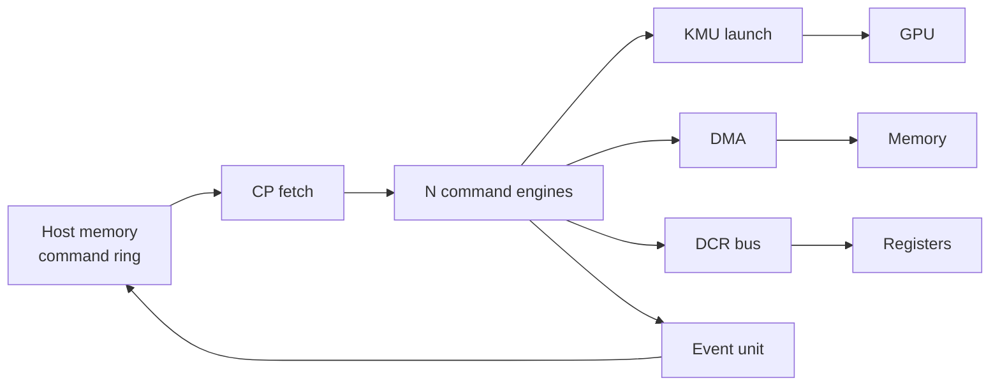

# Vortex 命令处理器

## 定义

CP（Command Processor）是 host 向 GPU 提交工作的唯一控制面：拷贝、DCR 编程、kernel launch、fence、event、cache maintenance。

## 如何工作

- N 个并行 command engine（每队列一个）。
- 4 个 round-robin arbiter 串行化共享资源：KMU launch、DMA、DCR bus、event unit。
- 命令 ring 在 host memory；CP 通过专用 AXI host port 取指并写回 completion。
- host 侧每命令成本：一次 memcpy 到 pinned ring + 一次 doorbell。
- 设备侧负责 fetch/decode/sequence/completion。

## 架构图

## 关键细节

- 命令 ABI：4B header + opcode payload，64B cache line 内打包。
- opcode 包括 `CMD_NOP`、`CMD_MEM_*`、`CMD_FENCE`、`CMD_KERNEL_LAUNCH` 等。
- FPGA（XRT/OPAE）上 CP 是唯一的 launch/DCR 路径。
- 设备编排（device-orchestrated work）依赖 CP 能执行完整命令流。

## 在项目中的位置

- 所属项目：[[Vortex]]
- 相关子系统：[[Vortex-SIMT]]、[[Vortex-Cache]]、[[Vortex-DXA]]

## 相关概念

- [[Software-Interface]]
- [[Performance-Modeling]]

## 自检问题

- 为什么命令 ring 放在 host memory？
- CP 的 4 个 arbiter 分别服务什么资源？
- 设备编排与 host 编排的取舍？
- DCR 与 MMIO 的区别？

## 来源

- `docs/designs/command_processor.md`
- `hw/rtl/cp/`
- `sw/runtime/include/vortex2.h`
