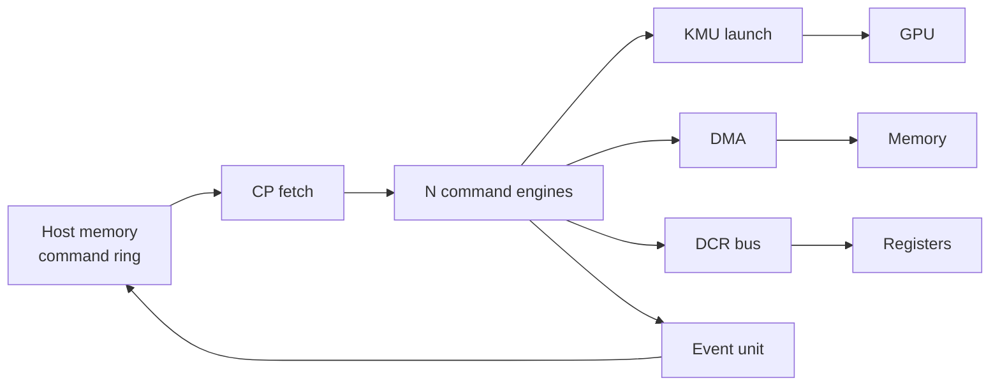

# Vortex 命令处理器

## 定义

CP（Command Processor，命令处理器，host 向 GPU 提交工作的唯一控制面；kernel 启动与设备配置）是 host 向 GPU 提交工作的唯一控制面：拷贝、DCR（device control register，设备控制寄存器；host 读写设备配置）编程、kernel（GPU 端并行函数；由 host 启动网格执行） launch、fence（内存栅栏，保证访存与命令顺序；同步）、event（事件，用于完成通知与跨队列依赖等待；异步同步）、cache maintenance。

## 如何工作

- N 个并行 command engine（每队列一个）。
- 4 个 round-robin arbiter（轮询仲裁器，按顺序轮流授予共享资源；多队列公平调度）串行化共享资源：KMU（kernel management unit，内核管理单元，负责 kernel 启动与参数配置；GPU 前端）launch、DMA（direct memory access，直接内存访问引擎，不占 CPU 搬数据；主机-设备拷贝）、DCR bus、event unit。
- 命令 ring（环形命令队列，host 与设备共享的生产者-消费者缓冲；批量提交）在 host memory；CP 通过专用 AXI（advanced extensible interface，片上总线协议；主机-设备高带宽互连）host port 取指并写回 completion。
- host 侧每命令成本：一次 memcpy 到 pinned（pinned memory，页锁定内存，DMA 可直接访问；避免额外拷贝）ring + 一次 doorbell（门铃寄存器，host 写寄存器通知设备有新命令；低延迟提交）。
- 设备侧负责 fetch/decode/sequence/completion。

## 架构图

## 关键细节

- 命令 ABI（application binary interface，二进制接口约定，规定命令编码与布局；软硬件契约）：4B header + opcode payload，64B cache line 内打包。
- opcode 包括 `CMD_NOP`、`CMD_MEM_*`、`CMD_FENCE`、`CMD_KERNEL_LAUNCH` 等。
- FPGA（field-programmable gate array，现场可编程门阵列，可重构硬件；原型验证与加速卡）（XRT/OPAE）上 CP 是唯一的 launch/DCR 路径。
- 设备编排（device-orchestrated work）依赖 CP 能执行完整命令流。

## 在项目中的位置

- 所属项目：[[Vortex]]
- 相关子系统：[[Vortex-SIMT]]、[[Vortex-Cache]]、[[Vortex-DXA]]

## 相关概念

- [[Software-Interface]]
- [[Performance-Modeling]]

## 自检问题

- 为什么命令 ring 放在 host memory？
- CP 的 4 个 arbiter 分别服务什么资源？
- 设备编排与 host 编排的取舍？
- DCR 与 MMIO 的区别？

## 概念速览

| 概念 | 是什么 | 使用场景 | 延伸 |
|---|---|---|---|
| CP | 命令处理器 | host 提交工作的控制面 | 所有拷贝、启动、配置命令都经它转发 |
| DCR | 设备控制寄存器 | host 读写设备配置 | 与 MMIO 类似，但可经 CP 批量下发 |
| kernel | GPU 端并行函数 | 并行计算启动 | launch 即把网格/线程块配置提交给 KMU |
| fence | 内存栅栏 | 访存与命令顺序 | 与 event 配合实现跨队列依赖 |
| event | 完成通知与依赖 | 异步同步、多队列 | 设备写回 event 后 host 或后续命令可等待 |
| round-robin arbiter | 轮询仲裁器 | 多队列共享资源 | 4 个 arbiter 分别服务 KMU、DMA、DCR、event |
| KMU | 内核管理单元 | kernel 启动与参数配置 | 与 DCR 配合完成 launch 前的寄存器设置 |
| DMA | 直接内存访问引擎 | 主机-设备与设备内拷贝 | 不占 CPU，与 CP 命令流水并行 |
| command ring | 环形命令队列 | host 批量提交 | 位于 host memory，设备通过 AXI host port 取指 |
| AXI | 片上总线协议 | 主机-设备高带宽互连 | CP 用专用 host port 取命令并写回 completion |
| pinned | 页锁定内存 | DMA 缓冲区 | 避免换页与额外拷贝，是低延迟提交的前提 |
| doorbell | 门铃寄存器 | 通知设备有新命令 | 一次写入即可触发设备取指，成本远低于 MMIO 轮询 |
| ABI | 二进制接口约定 | 命令编码与布局 | 4B header + payload 打包进 64B cache line，便于批量传输 |
| FPGA | 现场可编程门阵列 | 原型验证与加速卡 | XRT/OPAE 上 CP 是唯一 launch/DCR 路径，设备编排依赖它 |

## 来源

- `docs/designs/command_processor.md`
- `hw/rtl/cp/`
- `sw/runtime/include/vortex2.h`
