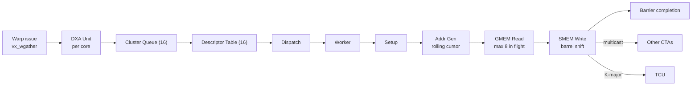

# Vortex DXA（异步拷贝 + 多播）

## 定义

DXA（Direct eXecution Accelerator，直接执行加速器：异步批量拷贝单元；张量数据搬运）是 NVIDIA Hopper TMA（Tensor Memory Accelerator，张量内存加速器，硬件异步搬运多维 tile；Transformer/GEMM 数据供给）风格的异步批量拷贝单元：一条 warp（线程束，GPU 中一起执行的线程组；SIMT 调度单位）指令启动 GMEM（global memory，设备全局显存；大容量数据）→LMEM（local memory，片上共享暂存内存；低延迟复用）的 tiled copy（多维分块拷贝，按 tile 描述符搬移数据；矩阵/图像搬运），warp 立即释放。

## 如何工作

- 操作：1–5 维 tiled copy、越界 clamp/constant fill、multicast（多播，一次读取向多个目的端复制；减少重复访存）、K-major transpose（按 K 维度重排为列主序，匹配 MMA 布局；GEMM 数据准备）。
- 描述符（descriptor，描述地址、尺寸、步长与边界行为的元数据；DMA 配置）：`base_addr` + `meta` + tile sizes + `cfill` + OOB（out-of-bounds，越界访问；由 clamp/constant fill 处理）bounds + strides + `smem_stride`。
- 集群级 `VX_dxa_core`：请求仲裁 → 16 项队列 → 描述符表 → dispatch → worker。
- 每个 worker：setup → addr_gen（滚动游标 + 4 级 odometer）→ GMEM read（≤8 in-flight）→ SMEM write（barrel shift，桶形移位器，单周期完成任意位宽移位；SMEM 写地址对齐）。
- multicast：`cta_mask` 多 bit 时，读一次 GMEM，按 `smem_stride` 重放到多个 CTA（cooperative thread array，协作线程组，对应 CUDA thread block；多播目标）。
- 完成：最后一个 cache line（缓存行，cache 与内存间传输的最小单位，通常 64B；一致性跟踪）带 completion flag，写入 LMEM 后通过 `txbar` 释放 barrier。

## 架构图

## 关键细节

- ISA：`INST_SFU_DXA`（SFU opcode 9），custom0/funct7=3；4 lane `vx_wgather` 打包参数。
- 描述符由 host 通过 DCR（device control register，设备控制寄存器；host 配置设备）写入，16 个 slot。
- 只有 GMEM→LMEM 方向，没有 LMEM→GMEM。
- K-major transpose 是 DXA 与 TCU 的主要耦合点。

## 在项目中的位置

- 所属项目：[[Vortex]]
- 相关子系统：[[Vortex-TCU]]、[[Vortex-Cache]]、[[Vortex-SIMT]]

## 相关概念

- [[Matrix-Accelerator]]
- [[Performance-Modeling]]

## 自检问题

- DXA 的 multicast 如何减少 GMEM 读放大？
- 为什么 DXA 只做 GMEM→LMEM？
- K-major transpose 如何配合 WGMMA 的 B 布局？
- 完成 flag 为什么挂在最后一个 cache line 上？

## 概念速览

| 概念 | 是什么 | 使用场景 | 延伸 |
|---|---|---|---|
| DXA | 异步批量拷贝加速器 | GMEM→LMEM 大 tile 搬运 | 只支持单方向拷贝，与 TCU 通过 K-major transpose 耦合 |
| TMA | Hopper 张量内存加速器 | 多维 tile 异步搬运 | DXA 以 TMA 为参照，warp 发起后立即释放 |
| warp | 一起执行的一组线程 | 发起 DXA 指令 | 一条 warp 指令即可启动整块拷贝，避免线程逐元素搬 |
| GMEM | 设备全局显存 | 大容量数据存放 | 读放大是多播要解决的核心问题 |
| LMEM | 片上共享暂存内存 | tile 落地与 TCU 复用 | DXA 只写 LMEM，不反向写回 GMEM |
| tiled copy | 多维分块拷贝 | 矩阵/图像搬运 | 用描述符而非逐地址指令表达，支持 1–5 维 |
| multicast | 一次读取复制到多个目的 | 多 CTA 共享同一 tile | 减少 GMEM 读放大，按 smem_stride 重放 |
| K-major transpose | 按 K 维重排布局 | 准备 WGMMA 的 B 操作数 | 是 DXA 与 TCU 的主要耦合点 |
| descriptor | 拷贝配置元数据 | DMA 参数化启动 | host 经 DCR 写入，共 16 个 slot |
| OOB | 越界访问处理 | 非对齐或超边界 tile | 支持 clamp 与 constant fill 两种策略 |
| barrel shift | 桶形移位器 | SMEM 写地址对齐 | 单周期任意位宽移位，隐藏地址对齐开销 |
| CTA | 协作线程组 | 多播目标、线程块 | 对应 CUDA thread block，由 cta_mask 选择 |
| cache line | 缓存与内存传输最小单位 | 一致性跟踪、完成通知 | completion flag 挂在最后一行，保证全部数据可见 |
| DCR | 设备控制寄存器 | host 配置 DXA 描述符 | 与 MMIO 类似但由 CP 统一转发，见命令处理器笔记 |

## 来源

- `docs/designs/dxa_async_copy_multicast.md`
- `hw/rtl/dxa/`
- `VX_config.toml`
