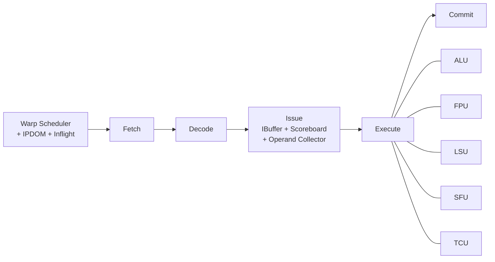

# Vortex SIMT 执行模型

## 定义

Vortex 用 SIMT（Single Instruction, Multiple Threads）执行：一个 warp 内的线程共享 PC，按线程掩码写回；warp 之间由 scheduler 时间复用。

## 如何工作

6 级流水：

```text
Schedule → Fetch → Decode → Issue → Execute → Commit
```

- Schedule：warp scheduler 选择下一个 PC；IPDOM stack 处理分支发散；inflight tracker 跟踪在飞指令。
- Fetch：取指 + I-cache。
- Decode：译码并通知 scheduler 控制指令。
- Issue：per-warp IBuffer、scoreboard、operand collector。
- Execute：ALU、FPU、LSU、SFU、TCU。
- Commit：写回寄存器并更新 scoreboard。

## 架构图



## 关键细节

- 每个 scheduler 每周期发一个 warp；`ISSUE_WIDTH` 可配。
- SIMD width = `NUM_THREADS`；ALU/FPU/LSU block 数随 issue width 缩放。
- 分支发散用 `SPLIT/JOIN/PRED` + IPDOM stack 管理线程掩码。
- warp 同步用 `BAR`；warp 创建用 `WSPAWN`，线程掩码控制用 `TMC`。
- 延迟隐藏主要靠 TLP（多 warp/多核），不是单线程 ILP。

## 在项目中的位置

- 所属项目：[[Vortex]]
- 相关子系统：[[Vortex-Cache]]、[[Vortex-TCU]]、[[Vortex-CommandProcessor]]

## 相关概念

- [[SIMT-and-Warp]]
- [[Pipeline-and-Hazards]]
- [[Performance-Modeling]]

## 自检问题

- 一个 warp 内分支发散时，IPDOM stack 如何工作？
- 为什么 Vortex 每周期只发一个 warp，却仍能保持高吞吐？
- scoreboard 如何跟踪多 warp 的寄存器依赖？
- `WSPAWN` 与 `BAR` 在 kernel 启动/同步中的角色？

## 来源

- `docs/designs/microarchitecture.md`
- `hw/rtl/core/VX_scheduler.sv`
- `hw/rtl/core/VX_ipdom_stack.sv`
