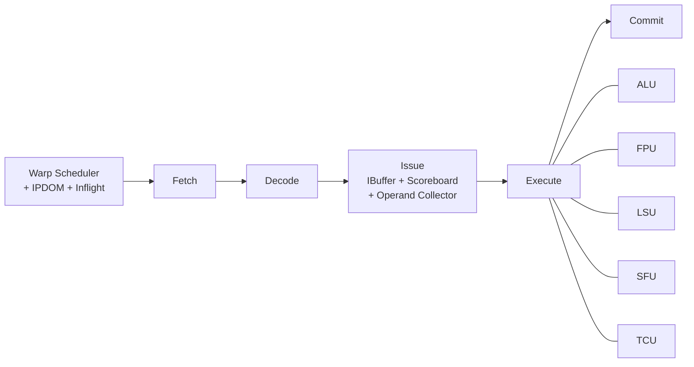

# Vortex SIMT 执行模型

## 定义

Vortex 用 SIMT（Single Instruction, Multiple Threads，单指令多线程：warp 内线程共享 PC、按线程掩码写回；GPU 通用计算执行模型）执行：一个 warp（线程束，GPU 中一起执行的线程组，通常 32 线程；SIMT 调度单位）内的线程共享 PC（program counter，程序计数器，指向当前指令地址；取指与分支控制），按线程掩码写回；warp 之间由 scheduler（warp 调度器，每周期选择就绪 warp 发射；隐藏访存与执行延迟）时间复用。

## 如何工作

6 级流水：

```text
Schedule → Fetch → Decode → Issue → Execute → Commit
```

- Schedule：warp scheduler 选择下一个 PC；IPDOM stack（immediate post-dominator stack，立即后支配栈，记录分支汇聚点与线程掩码；SIMT 分支发散处理）处理分支发散（warp 内线程走不同分支路径，需串行化并生成掩码；SIMT 性能关键）；inflight tracker 跟踪在飞指令。
- Fetch：取指 + I-cache（instruction cache，指令缓存，缓存取指数据；降低取指延迟）。
- Decode：译码并通知 scheduler 控制指令。
- Issue：per-warp IBuffer、scoreboard（记分板，跟踪指令与寄存器依赖，决定何时可发射；多 warp 调度）、operand collector（操作数收集器，为待发射指令聚集寄存器操作数；多发射流水线）。
- Execute：ALU、FPU、LSU（load/store unit，访存单元，执行地址计算与 load/store；内存访问）、SFU（special function unit，特殊功能单元，执行超越函数与自定义加速指令；图形与数学运算）、TCU。
- Commit：写回寄存器并更新 scoreboard。

## 架构图



## 关键细节

- 每个 scheduler 每周期发一个 warp；`ISSUE_WIDTH` 可配。
- SIMD（single instruction, multiple data，单指令多数据，一条指令并行处理多个数据元素；与 SIMT 对比） width = `NUM_THREADS`；ALU/FPU/LSU block 数随 issue width 缩放。
- 分支发散用 `SPLIT/JOIN/PRED` + IPDOM stack 管理线程掩码。
- warp 同步用 `BAR`；warp 创建用 `WSPAWN`，线程掩码控制用 `TMC`。
- 延迟隐藏主要靠 TLP（thread-level parallelism，线程级并行，多 warp/多核并发；GPU 延迟隐藏的主要手段），不是单线程 ILP（instruction-level parallelism，指令级并行，单线程内重叠多条指令；CPU 常用）。

## 在项目中的位置

- 所属项目：[[Vortex]]
- 相关子系统：[[Vortex-Cache]]、[[Vortex-TCU]]、[[Vortex-CommandProcessor]]

## 相关概念

- [[SIMT-and-Warp]]
- [[Pipeline-and-Hazards]]
- [[Performance-Modeling]]

## 自检问题

- 一个 warp 内分支发散时，IPDOM stack 如何工作？
- 为什么 Vortex 每周期只发一个 warp，却仍能保持高吞吐？
- scoreboard 如何跟踪多 warp 的寄存器依赖？
- `WSPAWN` 与 `BAR` 在 kernel 启动/同步中的角色？

## 概念速览

| 概念 | 是什么 | 使用场景 | 延伸 |
|---|---|---|---|
| SIMT | 单指令多线程执行模型 | GPU 通用计算 | 与 SIMD 对比：共享 PC，分支发散靠掩码串行化 |
| warp | 一起执行的一组线程 | GPU 调度与延迟隐藏 | 常见 32 线程；Vortex 每周期每 scheduler 发射一个 warp |
| PC | 程序计数器 | 取指与分支控制 | SIMT 下 warp 内线程共享 PC，发散时靠 IPDOM 栈分叉 |
| scheduler | warp 调度器 | 延迟隐藏、发射选择 | 与 scoreboard 配合，按就绪状态挑选 warp |
| IPDOM stack | 立即后支配栈 | 分支发散与重汇聚 | 记录分叉路径与掩码，JOIN 时合并线程 |
| 分支发散 | warp 内线程走不同路径 | 含分支/循环的 GPU kernel | 发散越严重有效并行度越低，是 SIMT 主要性能陷阱 |
| I-cache | 指令缓存 | 取指阶段 | 与数据 cache 分离，避免取指被 load/store 挤占 |
| scoreboard | 依赖跟踪结构 | 多 warp 发射 | 记录寄存器读写依赖，决定指令能否离开 IBuffer |
| operand collector | 操作数聚集单元 | 多发射流水线 | 把分散的寄存器/立即数整理成执行单元所需操作数 |
| LSU | 访存单元 | load/store、地址计算 | 与 LMEM 的 bank 划分直接相关 |
| SFU | 特殊功能单元 | 超越函数、图形数学 | Vortex 中 DXA 也以 SFU opcode 接入 |
| SIMD | 单指令多数据 | 向量/数据并行计算 | Vortex 的 SIMD width 等于 warp 线程数，但控制流仍按 SIMT 管理 |
| TLP | 线程级并行 | GPU 延迟隐藏 | 多 warp + 多核提供并发，区别于 CPU 的 ILP |
| ILP | 指令级并行 | CPU 流水线优化 | GPU 单线程 ILP 有限，主要靠 TLP 填满流水线 |

## 来源

- `docs/designs/microarchitecture.md`
- `hw/rtl/core/VX_scheduler.sv`
- `hw/rtl/core/VX_ipdom_stack.sv`
