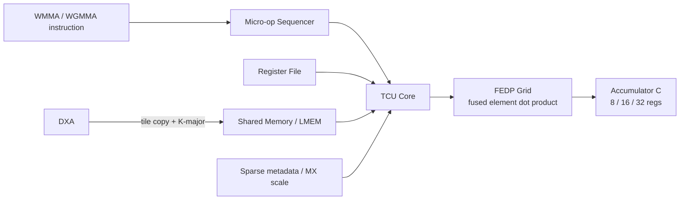

# Vortex TCU（WGMMA）

## 定义

Vortex 的张量核单元：支持 WMMA/WGMMA，把 `C += A·B` 的 tile 展开成 micro-op 序列，由 FEDP 网格执行。

## 如何工作

1. Decode 识别指令，micro-op sequencer 展开 tile。
2. 每个 micro-op 带 `(m,n,k)` 和寄存器信息。
3. Core 选择操作数：寄存器或 shared memory tile buffer。
4. FEDP（fused element dot product）网格计算。
5. 结果累加到 C 寄存器并提交。

## 架构图

## 关键细节

- 指令：`WMMA`、`WGMMA`、`WMMA_SP`、`WGMMA_SP`、`TCU_LD`；R-type，opcode `0x0B`，`funct7=2`。
- 累加器：8/16/32 个寄存器。
- A 可来自寄存器或 shared memory；WGMMA 的 B 必须来自 shared memory。
- 格式：FP32/TF32/FP16/BF16/FP8/BF8、MX（mxfp8/bf8/fp4/nvfp4）、INT8/INT4。
- 2:4 结构化稀疏；metadata 用 `XREG_0`（稀疏 lane 有效性）、`XREG_1`（MX scale）跟踪。
- 后端：TFR、DSP、BHF、FPNEW、DPI；FPGA 上 FEDP 乘法器映射到 DSP48。
- DXA 可把 GMEM tile 异步搬到 LMEM，并做 K-major transpose 直接喂 TCU。

## 在项目中的位置

- 所属项目：[[Vortex]]
- 相关子系统：[[Vortex-DXA]]、[[Vortex-SIMT]]、[[Vortex-Cache]]

## 相关概念

- [[Matrix-Accelerator]]
- [[Performance-Modeling]]

## 自检问题

- WMMA 与 WGMMA 的 tile 几何差异？
- 为什么 WGMMA 的 B 必须来自 shared memory？
- 2:4 稀疏的 metadata 如何被 scoreboard 跟踪？
- MX scale 与普通量化有什么区别？

## 来源

- `docs/designs/tensor_core_wgmma_engine.md`
- `VX_config.toml`
- `hw/rtl/tcu/`
