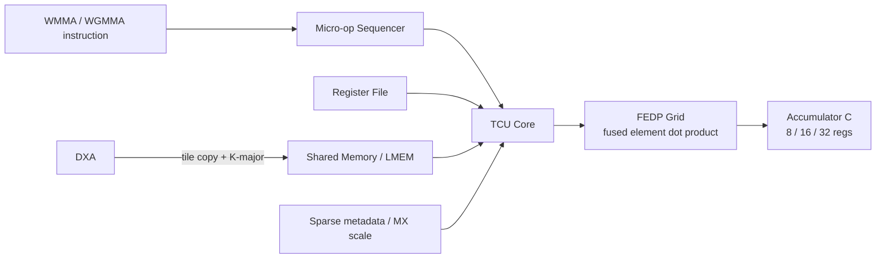

# Vortex TCU（WGMMA）

## 定义

Vortex 的张量核单元（TCU，tensor core unit，专用矩阵乘加硬件；AI 训练/推理加速）：支持 WMMA（warp-level matrix multiply-accumulate，warp 级矩阵乘加，单 warp 内协作；小 tile GEMM）/WGMMA（warpgroup-level matrix multiply-accumulate，跨 4 个 warp 的大 tile 矩阵乘加；Hopper 风格张量核），把 `C += A·B` 的 tile（分块矩阵，GEMM 的计算单元；缓存友好）展开成 micro-op（微操作，细粒度硬件操作；复杂指令分解）序列，由 FEDP（fused element dot product，融合元素点积阵列，并行计算乘加；张量核数据通路）网格执行。

## 如何工作

1. Decode 识别指令，micro-op sequencer 展开 tile。
2. 每个 micro-op 带 `(m,n,k)` 和寄存器信息。
3. Core 选择操作数：寄存器或 shared memory（片上共享内存，CUDA 中即 __shared__；warp 间交换与 tile 复用）tile buffer。
4. FEDP（fused element dot product）网格计算。
5. 结果累加到 C 寄存器并提交。

## 架构图

## 关键细节

- 指令：`WMMA`、`WGMMA`、`WMMA_SP`、`WGMMA_SP`、`TCU_LD`；R-type，opcode `0x0B`，`funct7=2`。
- 累加器：8/16/32 个寄存器。
- A 可来自寄存器或 shared memory；WGMMA 的 B 必须来自 shared memory。
- 格式：FP32/TF32/FP16/BF16/FP8/BF8、MX（microscaling，块共享指数的低精度格式族，如 mxfp8/bf8/fp4/nvfp4；低精度推理/训练）、INT8/INT4。
- 2:4 结构化稀疏（每 4 个元素保留 2 个非零，硬件跳过零乘；稀疏模型加速）；metadata 用 `XREG_0`（稀疏 lane 有效性）、`XREG_1`（MX scale）跟踪。
- 后端：TFR、DSP、BHF、FPNEW、DPI；FPGA 上 FEDP 乘法器映射到 DSP48（Xilinx FPGA 内嵌的乘加硬核；高性能算术映射）。
- DXA（Direct eXecution Accelerator，异步批量拷贝单元；GMEM→LMEM 的 tiled 搬运）可把 GMEM（global memory，设备全局显存；大容量数据存放）tile 异步搬到 LMEM（local memory，片上共享暂存内存；低延迟复用），并做 K-major transpose（按 K 维度重排为列主序，匹配 MMA 的 B 操作数布局；GEMM 数据准备）直接喂 TCU。

## 在项目中的位置

- 所属项目：[[Vortex]]
- 相关子系统：[[Vortex-DXA]]、[[Vortex-SIMT]]、[[Vortex-Cache]]

## 相关概念

- [[Matrix-Accelerator]]
- [[Performance-Modeling]]

## 自检问题

- WMMA 与 WGMMA 的 tile 几何差异？
- 为什么 WGMMA 的 B 必须来自 shared memory？
- 2:4 稀疏的 metadata 如何被 scoreboard 跟踪？
- MX scale 与普通量化有什么区别？

## 概念速览

| 概念 | 是什么 | 使用场景 | 延伸 |
|---|---|---|---|
| TCU | 张量核单元 | AI 训练/推理、GEMM | 通过 micro-op 把大矩阵指令分解为硬件可执行序列 |
| WMMA | warp 级矩阵乘加 | 小 tile GEMM | 单个 warp 内协作，操作数可来自寄存器或 shared memory |
| WGMMA | warpgroup 级矩阵乘加 | 大 tile GEMM、Hopper 风格 | B 操作数必须来自 shared memory，便于跨 warp 共享 |
| tile | 分块矩阵 | GEMM 与缓存友好计算 | tile 越大复用越高，但受寄存器/共享内存容量限制 |
| micro-op | 细粒度硬件操作 | 复杂指令分解执行 | 每条带 (m,n,k) 几何与寄存器信息，由 sequencer 展开 |
| FEDP | 融合元素点积阵列 | 张量核乘加计算 | FPGA 上乘法器映射到 DSP48，软硬件可对照 |
| shared memory | 片上共享内存 | tile 缓冲、warp 间交换 | WGMMA 的 B 操作数强制走 shared memory |
| MX | 块共享指数低精度格式 | FP8/FP4 推理与训练 | 与普通 INT 量化相比保留浮点动态范围 |
| 2:4 结构化稀疏 | 每 4 元素保留 2 个非零 | 稀疏模型推理 | 需要 metadata 描述有效 lane，硬件据此跳过零乘 |
| DSP48 | Xilinx FPGA 乘加硬核 | FPGA 原型上的矩阵运算 | FEDP 的乘法器在 FPGA 上映射到该硬核 |
| DXA | 异步批量拷贝单元 | GMEM→LMEM 数据供给 | 与 TCU 通过 K-major transpose 耦合，只做单向拷贝 |
| GMEM | 设备全局显存 | 大容量数据存放 | 与 LMEM 之间由 DXA 搬运，避免线程逐元素加载 |
| LMEM | 片上共享暂存内存 | tile 复用、TCU 操作数 | 默认至少 16KB，按 LSU lane 分 bank |
| K-major transpose | 按 K 维重排布局 | GEMM 的 B 操作数准备 | 使 shared memory 中的 tile 直接满足 MMA 的布局要求 |

## 来源

- `docs/designs/tensor_core_wgmma_engine.md`
- `VX_config.toml`
- `hw/rtl/tcu/`
