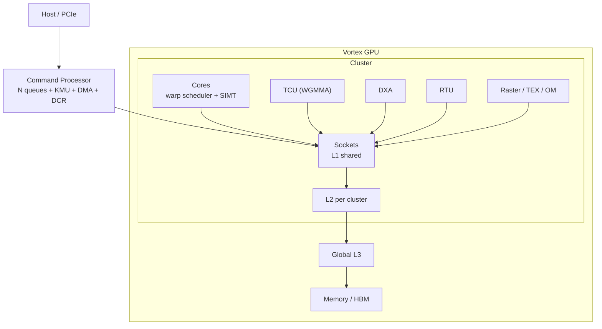

# Vortex

## 一句话定位

开源 RISC-V（开放、模块化的指令集架构；广泛用于 MCU、AI 加速器、边缘 NPU 与服务器） GPGPU（General-Purpose computing on GPU，用 GPU 承担非图形计算；HPC 与 AI 训练/推理） 全栈：SIMT（单指令多线程，warp 内线程共享 PC；GPU 执行模型） 执行模型 + 多核/多 cluster（集群，多个 socket 加共享 L2 的层次；扩展到多核 GPU） + 完整 GPU 软件栈（OpenCL/Vulkan/HIP）。

## 架构骨架

- ISA：RV32IMAFC / RV64IMAFDC + 自定义 SIMT 指令 + 加速器扩展
- 流水线：6 级（Schedule / Fetch / Decode / Issue / Execute / Commit）
- 执行：thread → warp（线程束，GPU 中一起执行的线程组，通常 32 线程；SIMT 调度单位） → core → socket（插槽，封装多个 core 的物理单元，常共享 L1；GPU 多核组织） → cluster
- 存储：L1（socket 共享）、L2/L3、MSHR（miss status holding register，跟踪未完成 cache miss 并合并请求；乱序/非阻塞访存）、LLC（last-level cache，末级缓存，全 GPU 共享；缓存一致性汇聚点）上的 AMO（atomic memory operation，原子读改写；GPU 全局同步与计数器）、TLB/PTW（TLB 缓存页表项，PTW 硬件遍历页表；GPU 虚拟内存地址转换）、LMEM（local memory，片上共享暂存内存，即 shared memory；warp 间数据交换与复用）
- 加速器：TCU（tensor core unit，张量核单元，把矩阵乘加展开成硬件流水，支持 WGMMA；AI 训练/推理）、DXA（Direct eXecution Accelerator，异步批量拷贝加速器；GMEM→LMEM 的 tiled 数据搬运）、RTU（ray tracing unit，硬件光追单元；实时光线求交）、光栅化/纹理/OM
- 系统：命令处理器 + KMU + DCR + PCIe AFU

## 架构图

## 关键子系统

- [[Vortex-SIMT]]
- [[Vortex-Cache]]
- [[Vortex-TCU]]
- [[Vortex-DXA]]
- [[Vortex-CommandProcessor]]
- [[Vortex-Graphics-RTU]]

## 相关概念

- [[SIMT-and-Warp]]
- [[Cache-and-Memory]]
- [[Matrix-Accelerator]]
- [[Performance-Modeling]]
- [[Verification-Fidelity]]

## 学习阶段

- [[Stage-3-GPU]]

## 代码入口

- `docs/designs/microarchitecture.md`
- `docs/designs/cache_subsystem.md`
- `docs/designs/tensor_core_wgmma_engine.md`
- `docs/designs/dxa_async_copy_multicast.md`
- `docs/designs/command_processor.md`
- `VX_config.toml`
- `hw/rtl/`
- `sim/simx/`

## 实验记录

- [ ] 跑 `sgemm`（simx）
- [ ] 改 warps/threads/issue-width，记录周期
- [ ] 跑 rtlsim，对比 simx
- [ ] 打开 L2/L3，观察性能变化
- [ ] 画一张 GPU 存储层次图

## 开放问题

- 为什么 L1 是 socket 共享而不是 per-core？
- 多核没有 L2 时为什么会丢 store？
- WGMMA 的 B 操作数为什么必须来自 shared memory？
- DXA multicast 如何减少 GMEM 读放大？

## 概念速览

| 概念 | 是什么 | 使用场景 | 延伸 |
|---|---|---|---|
| RISC-V | 开放、模块化的指令集架构 | MCU、AI 加速器、边缘 NPU、服务器 | 与 ARM/x86 相比可自由扩展自定义指令，Vortex 正是靠扩展加入 SIMT 与加速器指令 |
| GPGPU | 用 GPU 承担通用计算 | HPC、AI 训练/推理、科学计算 | 与纯图形 GPU 的区别在于可编程性与存储一致性支持 |
| SIMT | 单指令多线程执行模型 | GPU、GPGPU、AI 加速 | 与 SIMD 对比：共享 PC，靠线程掩码处理分支发散 |
| cluster | 多个 socket 加共享 L2 的层次 | 扩展到多核 GPU | 跨 cluster 访问必须经过 L3，否则无法保证一致性 |
| warp | 一起执行的一组线程 | GPU 调度与延迟隐藏 | 常见 32 线程；Vortex 中 warp 由 scheduler 时间复用 |
| socket | 封装多个 core 的物理单元 | 多核 GPU 组织 | 同一 socket 的 core 共享 L1，跨 socket 需经 L2/L3 |
| MSHR | 跟踪未完成 cache miss 的硬件表项 | 乱序访存、请求合并 | 每 bank 一个 MSHR，支持 fill forwarding 直接回填等待者 |
| LLC | 末级缓存，全 GPU 共享 | 缓存一致性、AMO 执行点 | Vortex 中 LLC 由配置决定落在 L1/L2/L3 哪一级 |
| AMO | 原子读改写操作 | 全局计数器、锁、归约 | 只在 LLC 执行，上层 cache 透传以保证原子性 |
| TLB/PTW | 页表项缓存与硬件页表遍历 | GPU 虚拟内存地址转换 | 与 CPU MMU 类似，但 GPU 需承受大量并发地址转换 |
| LMEM | 片上共享暂存内存 | shared memory、warp 间数据交换 | 按 LSU lane 分 bank；与 L1 数据缓存是不同物理结构 |
| TCU | 张量核单元 | AI 训练/推理、GEMM | 支持 WMMA/WGMMA，把 tile 运算展开为 micro-op |
| DXA | 异步批量拷贝加速器 | 大 tile 数据搬运、多播 | 只做 GMEM→LMEM，与 TCU 通过 K-major transpose 耦合 |
| RTU | 硬件光追单元 | 实时光线追踪 | 基于 BVH 遍历，与图形流水线共享 cache 层次 |

## 来源

- `README.md`
- `docs/designs/`
- `VX_config.toml`
