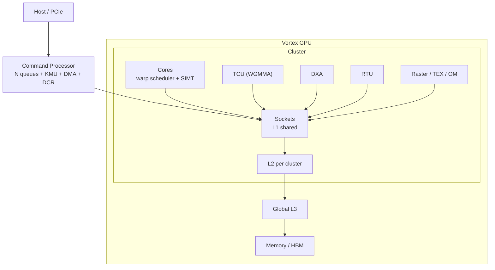

# Vortex

## 一句话定位

开源 RISC-V GPGPU 全栈：SIMT 执行模型 + 多核/多 cluster + 完整 GPU 软件栈（OpenCL/Vulkan/HIP）。

## 架构骨架

- ISA：RV32IMAFC / RV64IMAFDC + 自定义 SIMT 指令 + 加速器扩展
- 流水线：6 级（Schedule / Fetch / Decode / Issue / Execute / Commit）
- 执行：thread → warp → core → socket → cluster
- 存储：L1（socket 共享）、L2/L3、MSHR、LLC 上的 AMO、TLB/PTW、LMEM
- 加速器：TCU（WGMMA）、DXA、RTU、光栅化/纹理/OM
- 系统：命令处理器 + KMU + DCR + PCIe AFU

## 架构图

## 关键子系统

- [[Vortex-SIMT]]
- [[Vortex-Cache]]
- [[Vortex-TCU]]
- [[Vortex-DXA]]
- [[Vortex-CommandProcessor]]
- [[Vortex-Graphics-RTU]]

## 相关概念

- [[SIMT-and-Warp]]
- [[Cache-and-Memory]]
- [[Matrix-Accelerator]]
- [[Performance-Modeling]]
- [[Verification-Fidelity]]

## 学习阶段

- [[Stage-3-GPU]]

## 代码入口

- `docs/designs/microarchitecture.md`
- `docs/designs/cache_subsystem.md`
- `docs/designs/tensor_core_wgmma_engine.md`
- `docs/designs/dxa_async_copy_multicast.md`
- `docs/designs/command_processor.md`
- `VX_config.toml`
- `hw/rtl/`
- `sim/simx/`

## 实验记录

- [ ] 跑 `sgemm`（simx）
- [ ] 改 warps/threads/issue-width，记录周期
- [ ] 跑 rtlsim，对比 simx
- [ ] 打开 L2/L3，观察性能变化
- [ ] 画一张 GPU 存储层次图

## 开放问题

- 为什么 L1 是 socket 共享而不是 per-core？
- 多核没有 L2 时为什么会丢 store？
- WGMMA 的 B 操作数为什么必须来自 shared memory？
- DXA multicast 如何减少 GMEM 读放大？

## 来源

- `README.md`
- `docs/designs/`
- `VX_config.toml`
